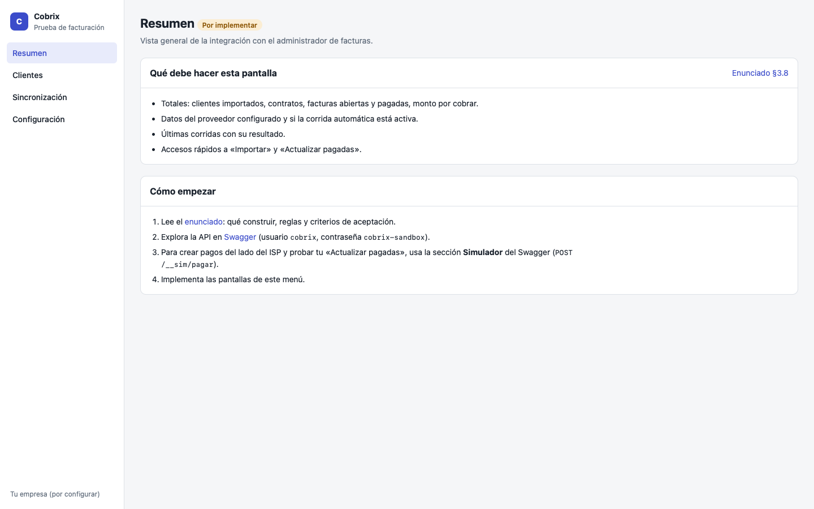

# Prueba técnica · Cobrix

Integra Cobrix con la API de un **administrador de facturas** de un ISP: importa clientes y facturas, aplica los pagos que el ISP ya cobró y construye el panel para operarlo.

**Empieza por el enunciado: [`docs/ENUNCIADO.md`](docs/ENUNCIADO.md).**

## Levantar el entorno

Requiere Node 24.

```bash
npm install
npm start
```

| Qué | Dónde |
| --- | --- |
| Panel (esqueleto con las pantallas por implementar) | http://127.0.0.1:4300 |
| API del administrador de facturas | http://127.0.0.1:4310/api/v1 |
| Swagger de la API | http://127.0.0.1:4310/docs |

Credenciales de la API: usuario `cobrix`, contraseña `cobrix-sandbox`.

Al levantarlo, el panel muestra cada pantalla con «Por implementar» y la lista de lo que debe hacer. Para crear pagos del lado del ISP, usa la sección «Simulador» del Swagger.



El enunciado incluye una **referencia de layout** (§3.7): qué va en cada pantalla. El diseño UI/UX es tuyo; puedes usar shadcn/ui, Tailwind o lo que prefieras.

## Qué hay en el repositorio

| Ruta | Qué es | ¿Se toca? |
| --- | --- | --- |
| `src/billing-api/` | API simulada del administrador, simulador de caja y Swagger | No |
| `data/billing-api.sqlite` | Base del administrador: 26 clientes, 27 contratos, 210 cuotas | No |
| `src/web/` | Esqueleto del panel: menú, estilos y pantallas vacías | Sí, o reemplázalo |
| `src/cobrix/` | Vacío: aquí va tu integración (ver su `README`) | Sí |
| `docs/ENUNCIADO.md` | Qué construir, reglas, criterios de aceptación y evaluación | — |
| `docs/API.md` | Guía de la API con ejemplos | — |

## Pruebas

```bash
npm test           # comprueba que la API entregada responde como se documenta
npm run typecheck
```

Agrega aquí tus propias pruebas (`test/*.test.ts`).
