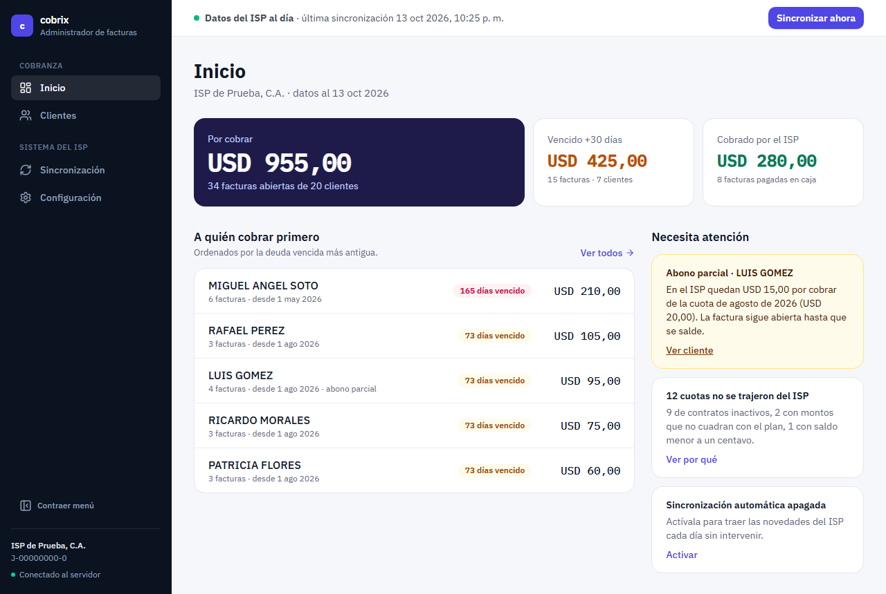
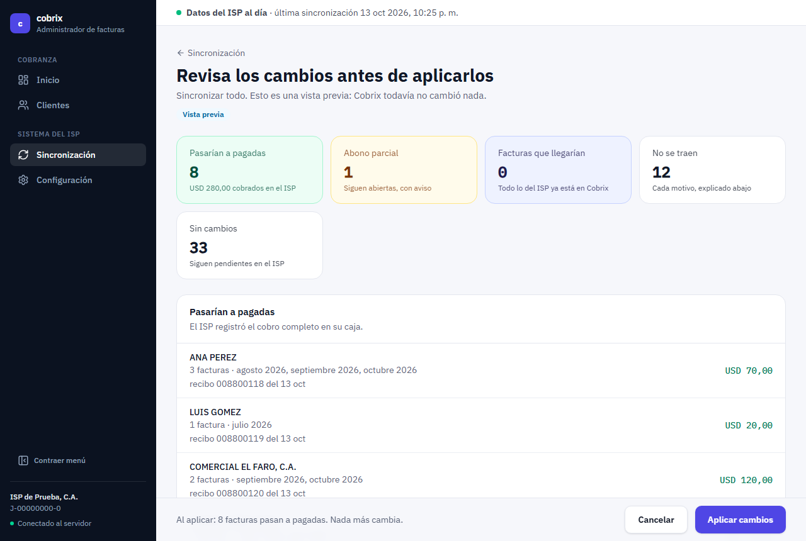
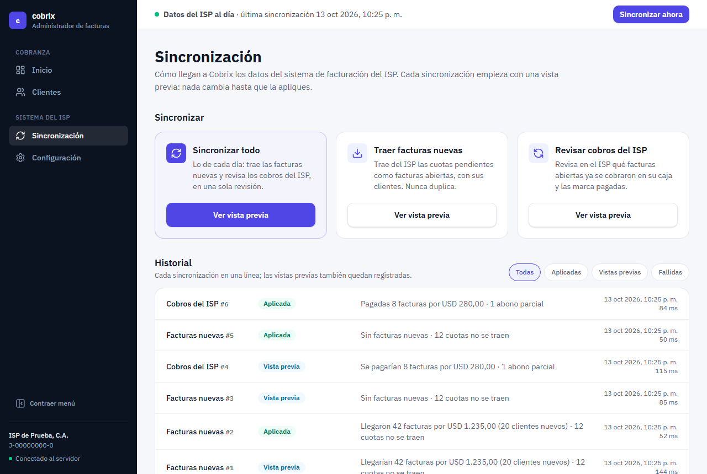
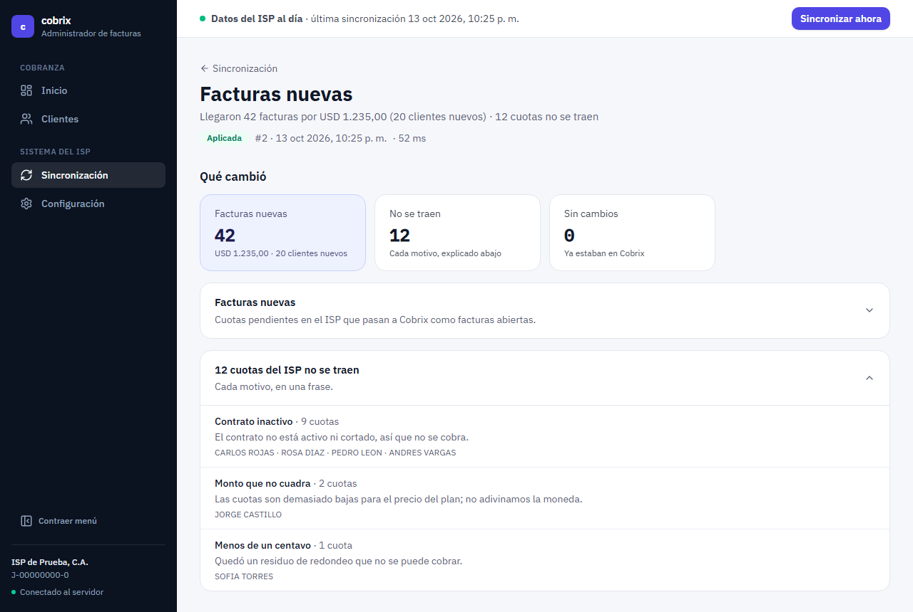
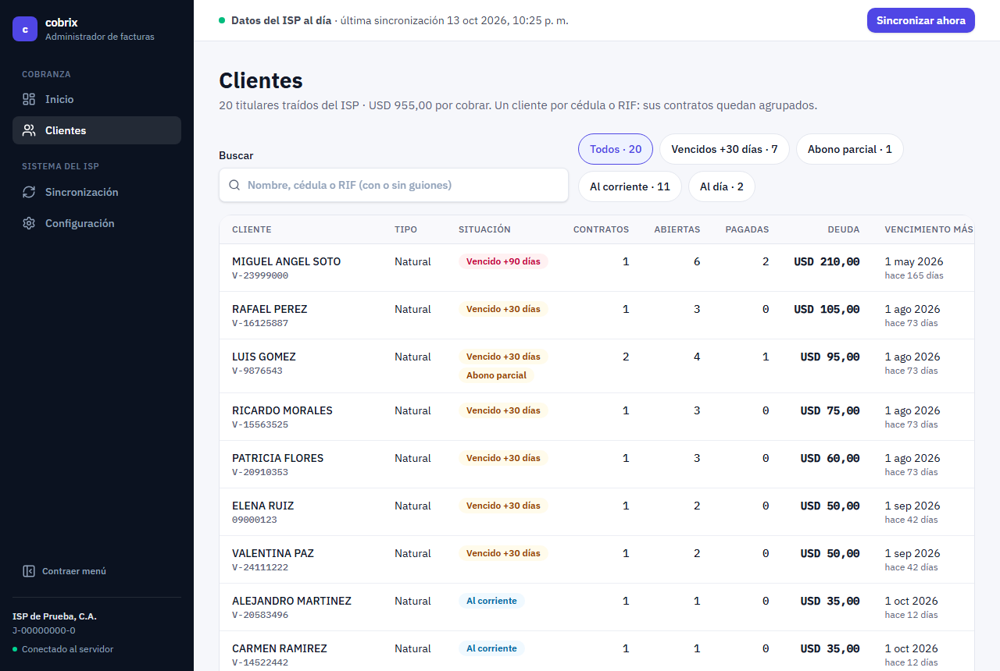
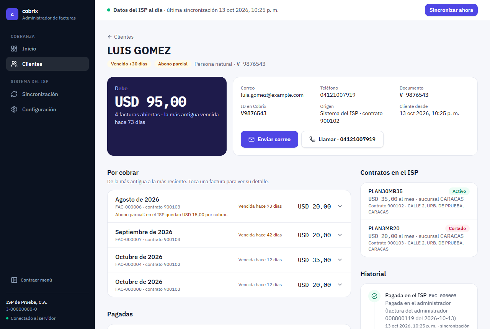
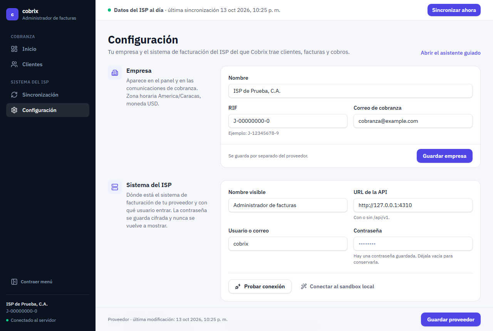
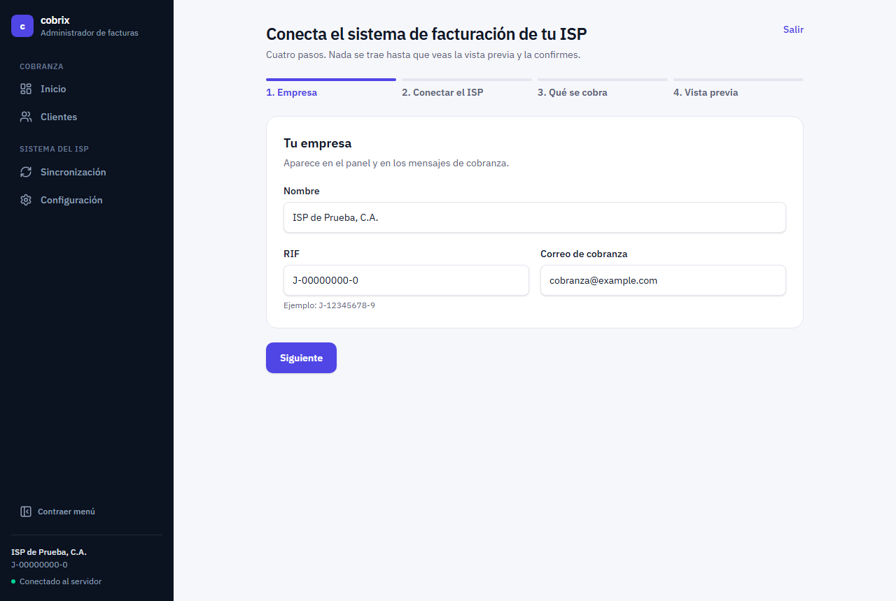
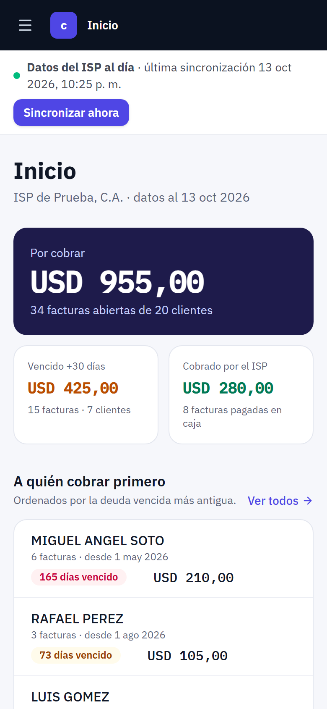
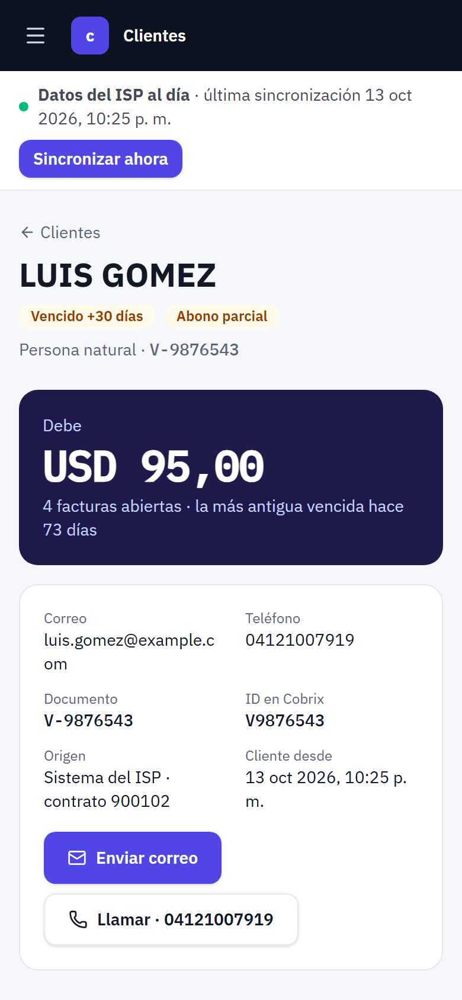

# Cobrix · Integración con el administrador de facturas

Prueba técnica de Roby Durán para Cobrix. Integra Cobrix con la API del administrador de facturas de un proveedor de internet: importa clientes y facturas, detecta los pagos que el ISP ya cobró y ofrece un panel para operarlo.

| Documento | Contenido |
|---|---|
| [Nota de entrega](docs/NOTA.md) | Decisiones, fuera de alcance, trabajo futuro, punto diferencial y uso de IA |
| [Documento de diseño](docs/DISENO.md) | Casos de uso, arquitectura, modelo de datos, reglas, contratos de API y diagramas |
| [Verificación](docs/VERIFICACION.md) | Cada requisito del enunciado con su implementación y su evidencia |
| [Bitácora](docs/BITACORA-IA.md) | Uso de IA y correcciones durante el desarrollo |
| [Enunciado](docs/ENUNCIADO.md) · [Guía de la API](docs/API.md) | Documentos provistos por Cobrix |

## Sobre esta entrega

Es un **MVP**: cubre todo lo que pide el enunciado, con los criterios de aceptación verificados por pruebas automáticas, y prioriza lo que más importa en una integración de cobranza: clasificar bien cada respuesta del ISP, no duplicar ni adivinar nada, y que el operador entienda qué cambió y por qué.

Lo construí con un proceso de trabajo profesional: análisis del enunciado y de la API antes de programar, reglas de negocio aisladas y probadas, pruebas de falla, integración continua, diseño de la interfaz a partir de las tareas del operador y documentación de cada decisión. Aun así, en un plazo de cuatro días pude haber pasado algo por alto; lo que dejé fuera a conciencia y lo que haría con más tiempo está en la [nota de entrega](docs/NOTA.md).

Recibiré con gusto cualquier crítica constructiva: me sirve para mejorar.

## Cómo levantarlo

Requiere **Node 24**. No necesita base de datos externa: Cobrix usa PostgreSQL embebido (PGlite), que se instala con las dependencias.

```bash
npm install
npm start
```

`npm start` compila el panel y levanta todo en un proceso:

| Qué | Dirección |
|---|---|
| Panel de Cobrix | http://127.0.0.1:4300 |
| API del administrador de facturas (sandbox) | http://127.0.0.1:4310/api/v1 |
| Swagger de la API y simulador de caja | http://127.0.0.1:4310/docs |

La fecha de la prueba queda fija en 2026-10-13, como pide el enunciado.

## Recorrido sugerido

1. **Asistente:** en Inicio pulsa **Empezar**. Completa la empresa, pulsa **Usar el sandbox local de la prueba** (o ingresa la URL `http://127.0.0.1:4310`, el usuario `cobrix` y la contraseña `cobrix-sandbox`), deja las reglas recomendadas y mira la **vista previa** (20 clientes, 42 facturas, USD 1.235,00, y las 12 cuotas que no se traen con su motivo). Pulsa **Traer clientes y facturas**.
2. **Caja del ISP:** en el Swagger, sección «Simulador», registra los pagos de §5 del enunciado con `POST /__sim/pagar` y `POST /__sim/anular`.
3. **Sincronizar ahora:** desde la barra superior. La vista previa muestra 8 facturas que pasarían a pagadas, 1 abono parcial y 33 sin cambios. Pulsa **Aplicar cambios**: quedan 34 abiertas por USD 955,00.
4. **Inicio y Clientes:** revisa a quién cobrar primero, filtra por «Abono parcial» y abre el expediente de LUIS GOMEZ.

En **Sincronización** están también las dos acciones del enunciado por separado («Traer facturas nuevas» y «Revisar cobros del ISP»), cada una con su vista previa (simulación) antes de aplicar, y el historial con el detalle por cuota.

Para volver al estado inicial: detén el servidor, borra la carpeta `data/cobrix/` (los datos de Cobrix), vuelve a ejecutar `npm start` y restablece el sandbox con `POST /__sim/reiniciar` desde el Swagger.

## Capturas

Tomadas con los datos de la prueba después del ciclo de §5 del enunciado.

| | |
|---|---|
|  **Inicio:** si los datos del ISP están al día, cuánto hay por cobrar, a quién cobrar primero y qué necesita atención. |  **Revisar cambios:** toda sincronización empieza con una vista previa que explica qué cambiaría; nada se aplica sin confirmar. |
|  **Sincronización:** las dos acciones del enunciado, más «Sincronizar todo», y el historial. |  **Detalle:** qué cambió, una fila por cuota con su motivo y los contadores técnicos. |
|  **Clientes:** búsqueda por nombre, cédula o RIF y filtros por situación. |  **Expediente:** deuda, contacto, facturas, contratos e historial. |
|  **Configuración:** por categorías, con la contraseña cifrada. |  **Asistente de primera vez:** cuatro pasos guiados hasta la primera vista previa. |

<p>
  
  
</p>

## Pruebas

```bash
npm test            # 72 pruebas: reglas, ciclo de aceptación, robustez, API del panel y entorno
npm run typecheck   # tipos del backend y del frontend
npm run build       # compila el panel
```

| Suite | Qué verifica |
|---|---|
| `backend/test/unit/reglas.test.ts` | Las reglas de §4, una por una, sin red ni base de datos |
| `backend/test/integration/ciclo.test.ts` | Los criterios de aceptación de §5 contra la API real del sandbox |
| `backend/test/integration/robustez.test.ts` | Fallas inyectadas: credenciales, token vencido, errores 5xx, respuestas contradictorias, topes, concurrencia |
| `backend/test/integration/servidor.test.ts` | API del panel, formato de errores, progreso en vivo y corrida automática |
| `backend/test/unit/logger.test.ts` | Registro estructurado y enmascarado de secretos |
| `test/entorno.test.ts` | El entorno provisto por Cobrix |

La integración continua (GitHub Actions) ejecuta `typecheck`, `test` y `build` en cada commit.

## Estructura

```
frontend/              Panel: React, Vite, Tailwind y componentes estilo shadcn/ui
backend/
  src/
    domain/            Reglas de negocio puras
    application/       Casos de uso y puertos (interfaces)
    infrastructure/    Adaptador del administrador de facturas, PostgreSQL, HTTP y registro
    main.ts            Raíz de composición
  test/                Pruebas unitarias y de integración
src/                   Entorno provisto por Cobrix: API simulada y simulador de caja
docs/                  Diseño, verificación, bitácora, enunciado y guía de la API
```

La arquitectura y sus motivos están en el [documento de diseño](docs/DISENO.md#4-arquitectura).

## Configuración por variables de entorno

| Variable | Por defecto | Uso |
|---|---|---|
| `PORT` | `4300` | Puerto del panel y de su API |
| `BILLING_API_PORT` | `4310` | Puerto de la API simulada |
| `HOST` | `127.0.0.1` | Interfaz de red |
| `SANDBOX_TODAY` | `2026-10-13` | Fecha fija de la prueba |
| `COBRIX_DATA_DIR` | `data/cobrix` | Datos de PostgreSQL de Cobrix |
| `COBRIX_SECRET_KEY` | Clave generada en `data/cobrix/secret.key` | Cifrado de la contraseña de la API |
| `LOG_LEVEL` | `info` | `debug`, `info`, `warn`, `error` o `silent` |
| `LOG_FORMAT` | legible | `json` para recolectores de registros |

## Desarrollo del panel

Con `npm start` corriendo, `npm run dev` levanta Vite en http://127.0.0.1:5173 con recarga en caliente y redirige `/api` al servidor de Cobrix.
