# Diseño y proceso: integración de Cobrix con un administrador de facturas

Documento de diseño de la prueba técnica. Explica **qué** se construye (casos de uso), **cómo** está armado (arquitectura, datos, flujos y secuencias) y **cómo se fue construyendo** (proceso, decisiones y hallazgos). Los diagramas están en Mermaid y GitHub los muestra renderizados.

| | |
|---|---|
| Autor | Roby Durán |
| Enunciado | [`ENUNCIADO.md`](ENUNCIADO.md) · API: [`API.md`](API.md) |
| Uso de IA | [`BITACORA-IA.md`](BITACORA-IA.md) |
| Estado | Backend completo y probado (57 pruebas). Panel en construcción. |

## Índice

1. [Contexto](#1-contexto)
2. [Actores](#2-actores)
3. [Casos de uso](#3-casos-de-uso)
4. [Arquitectura](#4-arquitectura)
5. [Modelo de datos](#5-modelo-de-datos)
6. [Flujos de decisión](#6-flujos-de-decisión)
7. [Diagramas de secuencia](#7-diagramas-de-secuencia)
8. [Estados](#8-estados)
9. [Robustez: qué puede fallar y qué pasa](#9-robustez-qué-puede-fallar-y-qué-pasa)
10. [Proceso de realización](#10-proceso-de-realización)
11. [Decisiones tomadas ante ambigüedades](#11-decisiones-tomadas-ante-ambigüedades)
12. [Pendiente](#12-pendiente)

---

## 1. Contexto

**Cobrix** cobra por cuenta de proveedores de internet (ISP) en Venezuela: recordatorios por WhatsApp, Pago Móvil, conciliación bancaria. Cada ISP lleva a sus clientes en su propio **administrador de facturas** (MikroWisp, WispHub, SmartISP…), con contratos, cuotas mensuales y cobros en caja.

Para cobrar, Cobrix necesita dos cosas de ese sistema:

1. **Importar** las cuotas pendientes como facturas abiertas, agrupadas por cliente.
2. **Enterarse de lo que el ISP ya cobró** en su caja, para marcar esas facturas como pagadas y dejar de cobrarlas.

El riesgo de negocio es asimétrico. Marcar como pagada una factura que no lo está significa **perder plata**. Importar lo que no corresponde significa **cobrarle a quien no se debe** (un cliente retirado, una cortesía). Por eso la regla que guía todo el diseño es **nunca adivinar**: ante la duda, no se actúa y se explica por qué.

## 2. Actores

| Actor | Tipo | Qué hace |
|---|---|---|
| **Operador de cobranza** | Persona | Configura la integración, lanza y simula corridas, revisa resultados, consulta clientes. |
| **Reloj del sistema** | Temporizador | Dispara la corrida automática diaria a la hora configurada (America/Caracas). |
| **Administrador de facturas** | Sistema externo | API del ISP: contratos, cuotas pendientes y libro de cuotas y pagos. |
| **Caja del ISP** | Sistema externo | Registra cobros y anulaciones. En la prueba la simulan las rutas `/__sim/*`. |

## 3. Casos de uso

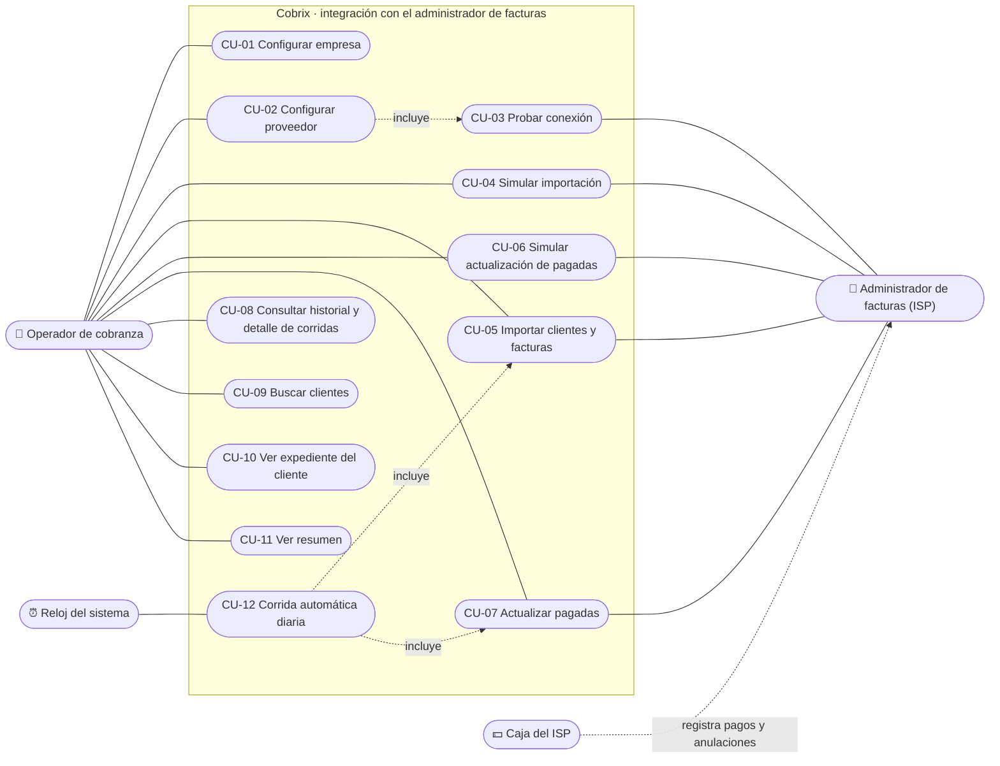

| CU | Nombre | Sección del enunciado | Backend | Panel |
|---|---|---|:-:|:-:|
| CU-01 | Configurar empresa | §3.1 | ✅ | ⏳ |
| CU-02 | Configurar proveedor | §3.1 | ✅ | ⏳ |
| CU-03 | Probar conexión | §3.1 | ✅ (cliente HTTP) | ⏳ |
| CU-04 / CU-05 | Simular importación / Importar | §3.2 | ✅ | ⏳ |
| CU-06 / CU-07 | Simular actualización / Actualizar pagadas | §3.3 | ✅ | ⏳ |
| CU-08 | Historial y detalle de corridas | §3.4 | ✅ (datos) | ⏳ |
| CU-09 | Buscar clientes | §3.5 | ✅ (datos) | ⏳ |
| CU-10 | Expediente del cliente | §3.6 | ✅ (datos) | ⏳ |
| CU-11 | Resumen | §3.8 | ✅ (datos) | ⏳ |
| CU-12 | Corrida automática diaria | §3.1 | ⏳ | ⏳ |

### CU-02 Configurar proveedor

| | |
|---|---|
| **Actor** | Operador de cobranza |
| **Objetivo** | Dejar lista la conexión con el administrador de facturas y las reglas de importación. |
| **Precondición** | — |
| **Postcondición** | La configuración queda guardada; la contraseña, cifrada. |

**Flujo principal**
1. El operador abre Configuración → Proveedor.
2. Escribe la URL de la API (con o sin `/api/v1`), el usuario y la contraseña.
3. Elige los estados de contrato que se importan (por defecto ACTIVO y CORTADO), la ventana de importación (3, 6, 9 o 12 meses, o sin ventana), el máximo de cuotas recientes por contrato (1 a 60 o todas), los días de gracia (0 a 60), los topes por corrida, los tipos de documento excluidos y la corrida automática.
4. Pulsa **Guardar**. El sistema valida cada campo y guarda.

**Flujos alternos**
- *4a. Datos inválidos:* se marca cada campo con un mensaje que dice cómo corregirlo, por ejemplo «Entre 0 y 60 días». No se guarda nada.
- *2a. Contraseña vacía al editar:* se conserva la actual. La contraseña **nunca** se devuelve al panel.
- *3a. Ningún estado elegido:* se rechaza, porque con eso nada se importaría.

### CU-03 Probar conexión

**Flujo principal:** inicia sesión en la API con la configuración del formulario y responde «Conectado: hay N contratos».

**Flujos alternos:** credenciales rechazadas, URL inválida, servicio caído o sin respuesta. Cada caso tiene un mensaje que dice qué pasó y qué revisar.

### CU-04 Simular importación · CU-05 Importar

| | |
|---|---|
| **Actor** | Operador (o el reloj, en CU-12) |
| **Objetivo** | Traer como facturas abiertas las cuotas pendientes que cumplen las reglas, con sus clientes. |
| **Precondición** | Proveedor configurado. No hay otra corrida en curso. |
| **Postcondición (importar)** | Clientes, contratos, facturas e historial creados en **una sola transacción**. La corrida queda registrada con sus contadores y una fila por cuota. |
| **Postcondición (simular)** | Solo queda registrada la corrida, marcada como simulación. **No se escribe ningún dato.** |

**Flujo principal**
1. El sistema registra la corrida «en curso». Si ya hay una, la rechaza.
2. Inicia sesión y pide la lista de contratos **sin** el filtro `estado`, porque con cualquier valor la API devuelve solo los activos.
3. Por cada contrato (4 en paralelo) pide sus cuotas pendientes y las **clasifica** con las reglas de §4 (ver [§6.1](#61-qué-cuota-se-importa)).
4. Para las cuotas elegibles mira el estado de Cobrix: si ya existe, «ya importada»; si se pasa de un tope, «frenada por tope»; si no, se importa.
5. *(Solo importar)* Escribe todo en una transacción: clientes nuevos, contratos, facturas `FAC-000001…` y los eventos del historial.
6. Cierra la corrida como «completada» con sus contadores.

**Flujos alternos**
- *2a. Credenciales malas o API caída:* la corrida queda **fallida** con el error, y no se escribe nada.
- *2b. La lista no coincide con su propia paginación:* la corrida falla. No se importa a medias.
- *3a. Un contrato no responde (5xx, red) tras reintentar:* se registra como «consulta fallida» y se sigue con los demás. La corrida termina «completada con avisos» y la siguiente corrida trae lo que faltó.
- *3b. Token vencido:* se vuelve a iniciar sesión una sola vez y se reintenta.
- *3c. Respuesta que se contradice* (filas de otro contrato, cuotas duplicadas, cabecera que cambia, periodo ilegible): el contrato queda fuera, con el motivo.
- *5a. Falla al escribir:* se revierte la transacción y la corrida queda fallida.

**Reglas que aplica:** ver [§6.1](#61-qué-cuota-se-importa).

### CU-06 Simular actualización · CU-07 Actualizar pagadas

| | |
|---|---|
| **Objetivo** | Marcar pagadas las facturas abiertas que el ISP ya cobró por completo. |
| **Precondición** | Hay facturas abiertas. No hay otra corrida en curso. |
| **Postcondición** | Facturas pagadas con su fecha y la factura del administrador que las pagó. Evento «pagada en el ISP» en el historial. |

**Flujo principal**
1. Agrupa las facturas abiertas por contrato.
2. Por contrato, lee el **libro de cuotas** (`pago_informacion`) en la ventana configurada (por defecto 7 meses), hasta hoy.
3. Si alguna factura no aparece en el libro, por ejemplo la cuota del mes en curso, **relee el contrato** para ver si sigue pendiente.
4. Clasifica cada factura (ver [§6.2](#62-qué-factura-está-pagada)).
5. *(Solo actualizar)* En una transacción marca las pagadas y guarda el saldo que informa el ISP en los abonos parciales.

**Flujos alternos**
- *2a. Libro con filas de otro contrato:* las facturas de ese contrato quedan «en revisión» y **ninguna** se marca pagada.
- *4a. Abono parcial:* se informa, pero la factura sigue abierta con su saldo intacto.
- *4b. Exonerada (saldo 0 sin nada pagado):* no es un pago. Queda «en revisión».
- *4c. No aparece en el libro ni en el contrato:* **sin evidencia**. Nunca se marca pagada.

### CU-08 a CU-11 Consultas

- **CU-08 Historial de corridas:** tipo, fecha, simulación o no, estado y resumen. El detalle muestra contadores destacados, todos los contadores y una fila por cuota con su resultado y motivo.
- **CU-09 Clientes:** búsqueda por nombre, cédula o RIF. Columnas: documento, tipo (natural o jurídico), contratos, facturas abiertas y pagadas, deuda y vencimiento más antiguo.
- **CU-10 Expediente:** totales, datos del cliente, contratos en el administrador, facturas (número Cobrix, cuota, periodo, vencimiento, corte, total, saldo, estado) e historial.
- **CU-11 Resumen:** totales, proveedor configurado, estado de la corrida automática, últimas corridas y accesos rápidos.

### CU-12 Corrida automática diaria

A la hora configurada (America/Caracas), si está activa: **importar y después actualizar pagadas**. Se guarda la última fecha ejecutada para no correr dos veces el mismo día, incluso si el servicio se reinicia.

---

## 4. Arquitectura

### 4.1 Componentes

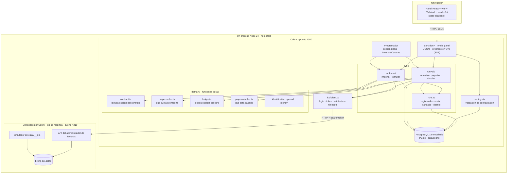

### 4.2 Capas y responsabilidades

| Capa | Carpeta | Responsabilidad | Depende de |
|---|---|---|---|
| **Dominio** | `src/cobrix/domain/` | Reglas de §4 como **funciones puras**: reciben datos, devuelven decisiones. Sin red, sin base, sin fechas implícitas. | Nada |
| **Cliente ISP** | `src/cobrix/isp/` | Transporte: login, token de 2 h, reintentos, timeouts, mensajes de error para el operador. Devuelve los cuerpos como `unknown`: no interpreta. | `fetch` |
| **Sincronización** | `src/cobrix/sync/` | Orquesta las corridas en dos fases: leer y decidir, después escribir. Contadores y detalle. | Dominio, cliente, base |
| **Configuración** | `src/cobrix/settings.ts` | Lectura, validación con errores por campo y guardado. | Base |
| **Persistencia** | `src/cobrix/db/` | Esquema Postgres, apertura, cifrado de la contraseña. | PGlite |
| **Panel** | `panel/` *(siguiente)* | Pantallas del operador. | API del panel |

**Por qué así.** La parte más evaluada (35 %) es la clasificación. Al dejarla en funciones puras, cada regla se prueba con datos armados en milisegundos, sin levantar la API. La API real se usa en las pruebas de punta a punta.

### 4.3 Stack y por qué

| Elección | Alternativa considerada | Motivo |
|---|---|---|
| Node 24 + TypeScript sin compilar (type stripping) | Express, Nest | Es el stack del esqueleto. Menos dependencias significa menos que revisar. |
| **PostgreSQL vía PGlite** (Postgres 18 en WebAssembly, en proceso) | PostgreSQL de servidor, SQLite | Se pidió Postgres. Con PGlite el evaluador no instala nada: `npm install && npm start`. Es SQL de Postgres real (`numeric`, `jsonb`, secuencias, índices parciales). |
| Montos en **centavos enteros** y `numeric(14,2)` en la base | `float` | La API manda `24.998683`; con flotantes, 0,1 + 0,2 ≠ 0,3. |
| `node:test` | Jest, Vitest | Ya es el que usa el proyecto entregado y su CI. |
| React + Vite + Tailwind + shadcn/ui *(siguiente)* | HTML del servidor | Sugerido por el enunciado. Componentes accesibles y consistentes. |

### 4.4 Estructura del repositorio

```
src/
  billing-api/        ← entregado, no se toca (API simulada + simulador de caja)
  shared/dates.ts     ← entregado (fechas civiles en America/Caracas, SANDBOX_TODAY)
  cobrix/
    domain/           ← reglas puras: contract, import-rules, ledger, payment-rules,
                        identification, period, money
    isp/client.ts     ← cliente HTTP del administrador
    db/               ← database (PGlite), schema, secret (AES-256-GCM)
    sync/             ← runs (común), import, paid
    settings.ts       ← configuración y validación
test/
  reglas.test.ts      ← §4 regla por regla (dominio puro)
  ciclo.test.ts       ← §5 de punta a punta contra la API real
  robustez.test.ts    ← fallas inyectadas: 401, 500, contradicciones, topes, concurrencia
  entorno.test.ts     ← entregado (con la corrección de rutas en Windows)
docs/
  DISENO.md · BITACORA-IA.md · ENUNCIADO.md · API.md
```

---

## 5. Modelo de datos

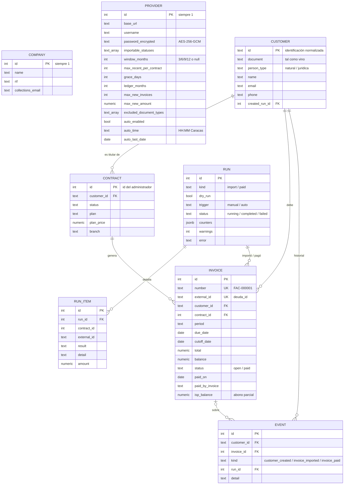

**Garantías que da la base (no solo el código):**

| Garantía | Cómo |
|---|---|
| Un cliente por titular | `customer.id` = identificación normalizada (PK) |
| Una factura por cuota, idempotencia | `invoice.external_id UNIQUE` + `ON CONFLICT DO NOTHING` |
| Una sola corrida a la vez, incluso entre procesos | Índice único parcial `run_one_in_progress … WHERE status = 'running'` |
| Corrida interrumpida no bloquea para siempre | Al arrancar, las que quedaron «en curso» pasan a fallidas con el motivo |
| Pagada ⇔ tiene fecha de pago | `CHECK ((status = 'paid') = (paid_on IS NOT NULL))` |
| Rangos de configuración | `CHECK` en ventana, gracia, máximo de cuotas, hora `HH:MM` |

---

## 6. Flujos de decisión

### 6.1 Qué cuota se importa

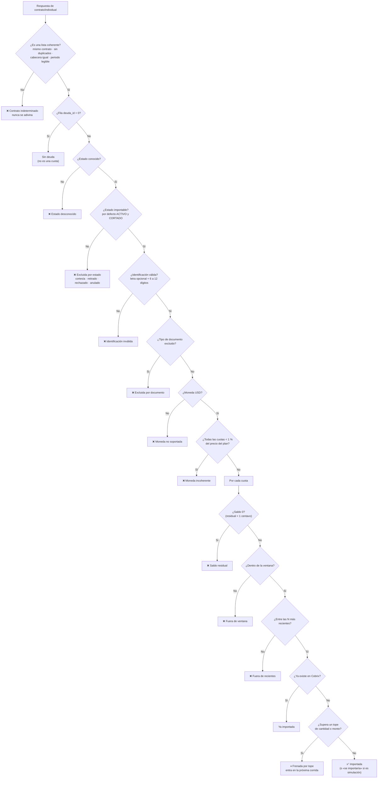

### 6.2 Qué factura está pagada

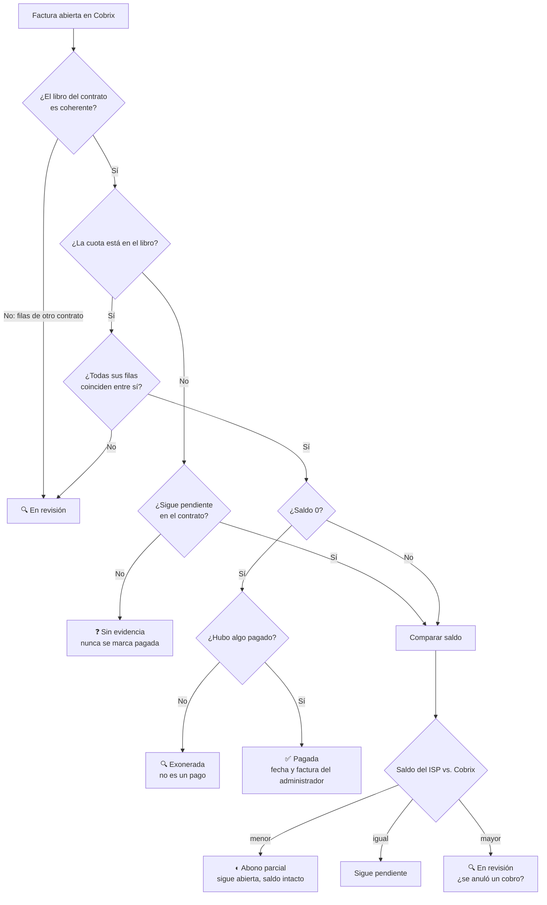

---

## 7. Diagramas de secuencia

### 7.1 Importar (y simular)

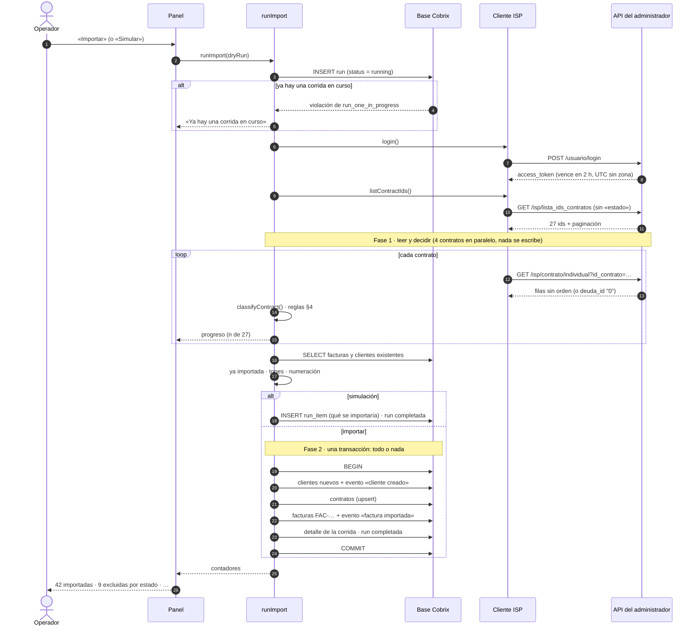

### 7.2 Actualizar pagadas (y simular)

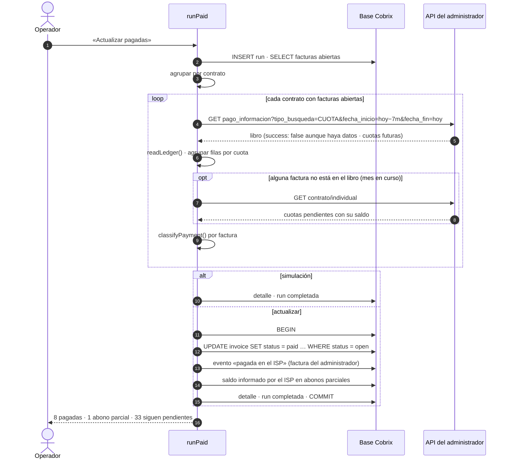

### 7.3 Token vencido con consultas en paralelo

Esta secuencia corresponde al bug n.º 4 de la bitácora, ya corregido: un solo login sirve a todas las consultas que esperaban.

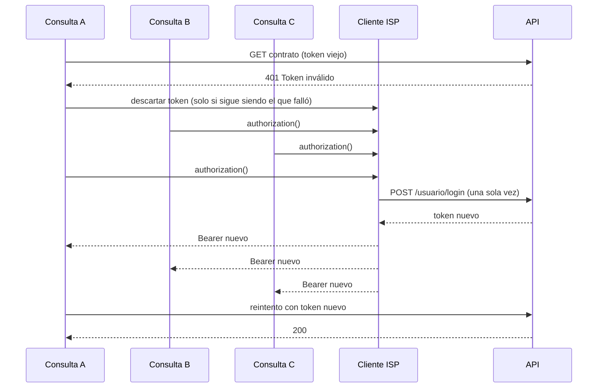

### 7.4 Ciclo de aceptación (§5)

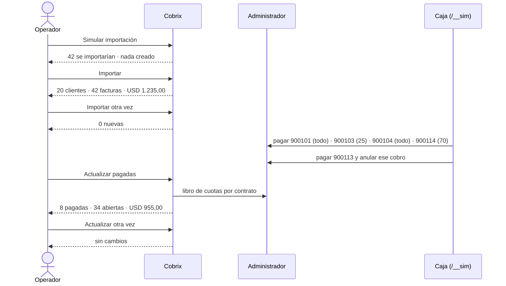

---

## 8. Estados

### 8.1 Factura

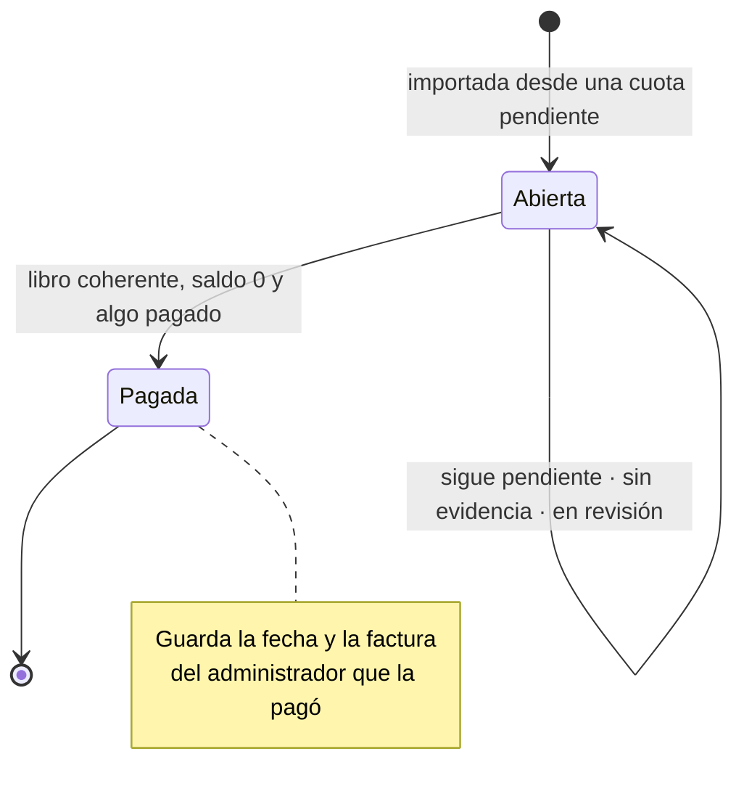

### 8.2 Corrida

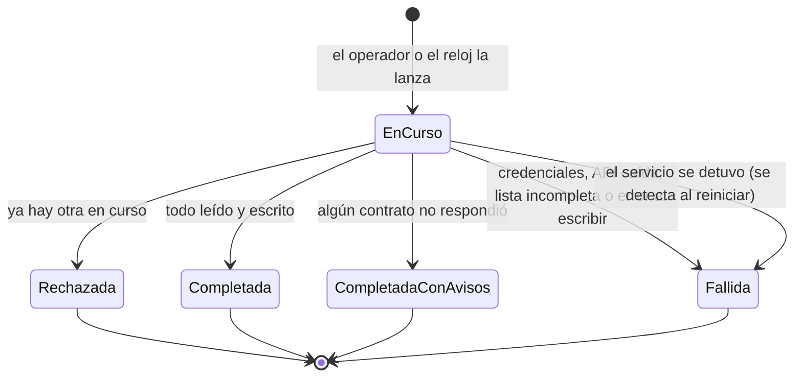

`CompletadaConAvisos` se guarda como `completed` con `warnings > 0`.

---

## 9. Robustez: qué puede fallar y qué pasa

| Situación | Comportamiento | Prueba |
|---|---|---|
| Credenciales malas | Corrida **fallida** con «La API rechazó las credenciales: «Contraseña Incorrecta». Revisa…». No se escribe nada. | `robustez` |
| API caída o URL errada | Fallida: «No se pudo conectar con la API en …» | `robustez` |
| Token vencido a mitad de corrida | Un solo re-login y sigue | `robustez` |
| Un contrato responde 500 | Se reintenta; si sigue fallando, se registra y la corrida sigue. La siguiente corrida lo trae. | `robustez` |
| Filas de otro contrato, duplicadas, estado desconocido, respuesta que no es lista | El contrato queda fuera con el motivo | `robustez`, `reglas` |
| Lista de contratos incompleta | Fallida: no se importa a medias | `robustez` |
| `success: false` con datos | Se ignora el campo; se valida la forma | `reglas` |
| Libro con filas de otro contrato | Facturas en revisión; ninguna pagada | `robustez` |
| Fila del libro ilegible | Solo esa cuota queda en revisión | `reglas` |
| Cuota fuera del libro y del contrato | Sin evidencia; nunca pagada | `robustez` |
| Dos corridas a la vez | La segunda se rechaza (candado en la base) | `robustez` |
| Topes | Lo que excede queda frenado y entra en la siguiente | `robustez` |
| Repetir importar o actualizar | No duplica ni reabre nada | `ciclo` |
| El servicio muere en plena corrida | Al reiniciar, la corrida queda fallida con el motivo | código (`openDatabase`) |

---

## 10. Proceso de realización

### 10.1 Cronología

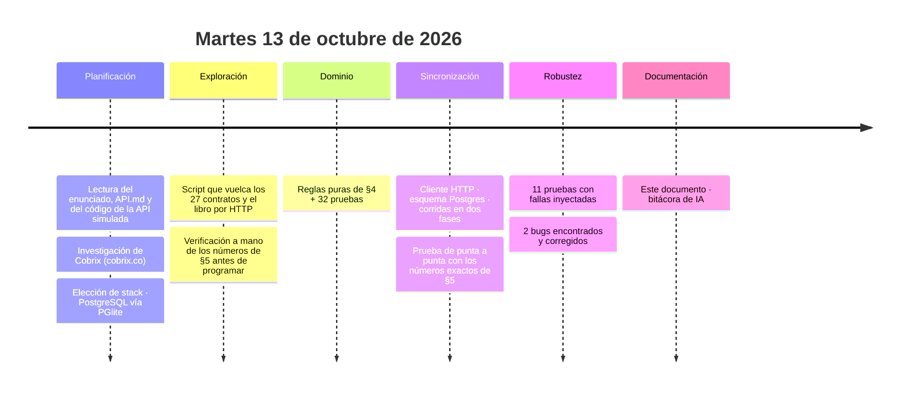

### 10.2 Método de trabajo

1. **Entender antes de programar.** Además de leer el enunciado, se leyó el **código** de la API simulada, para ver cómo arma el libro y cómo simula pagos y anulaciones, y se volcaron los datos reales por HTTP. Con eso se llegó a los números de §5 a mano (54 pendientes − 9 por estado − 2 moneda incoherente − 1 residual = **42 cuotas, USD 1.235**) antes de escribir una regla.
2. **Reglas primero, pantallas después.** Cada regla de §4 vive en una función pura con su prueba. La UI solo muestra decisiones ya tomadas y probadas.
3. **Las pruebas como especificación.** `ciclo.test.ts` reproduce §5 literalmente contra la API real. Si un número cambia, la prueba falla.
4. **Romper a propósito.** `robustez.test.ts` pone un `fetch` interceptor delante de la API real para inyectar 401, 500, contradicciones y concurrencia. Así aparecieron 2 bugs que el camino feliz no mostraba.
5. **Commits por hito**, en español y con el porqué. El primer commit es el proyecto **tal como se entregó**, para que el diff muestre solo lo propio.
6. **Bitácora de IA mientras se trabaja**, no reconstruida al final.

### 10.3 Hallazgos sobre la API (verificados, no supuestos)

| Hallazgo | Consecuencia en el diseño |
|---|---|
| `lista_ids_contratos` con **cualquier** `estado` devuelve solo los activos | Se llama sin `estado` |
| `contrato/individual` devuelve una lista sin envoltorio y sin orden; `deuda_id: "0"` = sin deuda | Lector estricto; se ordena por periodo |
| `deuda` viene redondeada a centavos (SOFIA: 0,001317 → 0) | Ese es el «saldo residual» que no se importa |
| JORGE CASTILLO: «USD» con cuotas de 0,05 y plan de 20 | Regla de moneda incoherente (< 1 % del plan) |
| El libro trae una fila por cuota **y por factura** que la tocó, cada una con el estado **actual** | «Todas las filas coinciden» como condición de pago |
| Una cuota sin cobros aparece con fecha = fin de su mes; con `fecha_fin = hoy`, la del mes en curso no aparece | Se relee el contrato cuando falta en el libro |
| Exonerada = `descuento: -tarifa`, saldo 0, pagado 0 | El descuento admite signo; exonerada ≠ pagada |
| Una anulación deja la fila de la factura anulada, pero devuelve el saldo | Se decide por el saldo, no por la existencia de un cobro |
| Cuotas «fantasma» en el libro que no están pendientes (ANA, 2025-08) | Se busca por `id_cuota`; nunca se importa desde el libro |
| `/usuario/me` responde siempre 500 | No se usa para «Probar conexión» |
| Sin `fecha_inicio`/`fecha_fin`, el libro responde una ventana fija de 2025 | Siempre se envían fechas |

### 10.4 Métricas actuales

| | |
|---|---|
| Pruebas | **57** (32 de reglas, 11 del ciclo §5, 11 de robustez, 3 del entorno entregado), todas pasan |
| Criterios de §5 | todos verificados automáticamente |
| Commits | 5 (+ este documento) |

---

## 11. Decisiones tomadas ante ambigüedades

| Tema | Decisión | Por qué |
|---|---|---|
| Moneda incoherente | El contrato se descarta si **todas** sus cuotas con saldo están < 1 % del plan | Un residuo chico en un contrato normal no debe bloquear el cobro del resto. |
| Topes por corrida | Al alcanzar un tope, la corrida **se frena**: lo siguiente queda frenado aunque quepa | Es predecible y no salta cuotas viejas para meter otras más baratas. |
| Identificación sin letra (`09000123`) | Se acepta (natural), pero el filtro por tipo **no** la excluye | No se adivina que es una V. |
| Dos cuotas del mismo periodo en un contrato | El contrato queda indeterminado | Es la forma de «cuota duplicada» que no se puede resolver sin adivinar. |
| Abono parcial | Se guarda el saldo que informa el ISP para mostrarlo; el saldo de Cobrix **no** cambia | Así cuadra §5 (USD 955) y Cobrix solo aplica cuotas saldadas. |
| Exonerada | «En revisión», no pagada ni sin evidencia | Hay evidencia, pero no es un pago: lo decide una persona. |
| Saldo del ISP mayor que el de Cobrix | «En revisión» con la sugerencia de un cobro anulado | Puede pasar si se anula un cobro previo a la importación. |
| Contratos guardados | Todos los del cliente, importables o no | El expediente muestra «contratos en el administrador»: el retirado también es contexto. |
| Datos de contacto | Se toman al crear el cliente | Evita que un contrato viejo pise datos. Se anota como mejora. |
| Ventana del libro | Desde «hoy − N meses» hasta hoy; N por defecto 7 (0 = 12) | Como en la referencia de Cobrix. |

## 12. Pendiente

- [ ] API HTTP del panel y progreso en vivo de la corrida (SSE).
- [ ] Panel: Resumen, Configuración (con «Probar conexión»), Sincronización y detalle de corrida, Clientes, Expediente.
- [ ] Corrida automática diaria (CU-12).
- [ ] README con cómo levantarlo y nota final (decisiones, fuera de alcance, con más tiempo, punto diferencial).
