# Documento de diseño

Integración de Cobrix con el administrador de facturas de un proveedor de internet (ISP).

| | |
|---|---|
| Autor | Roby Durán |
| Referencias | [Enunciado](ENUNCIADO.md) · [Guía de la API del ISP](API.md) · [Bitácora de desarrollo](BITACORA-IA.md) · [Verificación](VERIFICACION.md) |
| Estado | Sincronización, API y panel completos y probados. |

## Contenido

1. [Contexto y objetivo](#1-contexto-y-objetivo)
2. [Actores](#2-actores)
3. [Casos de uso](#3-casos-de-uso)
4. [Arquitectura](#4-arquitectura)
5. [Modelo de datos](#5-modelo-de-datos)
6. [Reglas de decisión](#6-reglas-de-decisión)
7. [Contratos de API](#7-contratos-de-api)
8. [Diagramas de secuencia](#8-diagramas-de-secuencia)
9. [Diagramas de estado](#9-diagramas-de-estado)
10. [Manejo de errores y registro](#10-manejo-de-errores-y-registro)
11. [Proceso de desarrollo](#11-proceso-de-desarrollo)
12. [Decisiones de diseño](#12-decisiones-de-diseño)

---

## 1. Contexto y objetivo

Cobrix gestiona la cobranza de proveedores de internet. Cada ISP registra a sus clientes, contratos, cuotas mensuales y cobros en su propio administrador de facturas. La integración que construí resuelve dos necesidades:

1. **Importar** las cuotas pendientes como facturas abiertas, agrupadas por cliente.
2. **Detectar los cobros** que el ISP ya registró en su caja, para marcar esas facturas como pagadas y dejar de gestionarlas.

Un error en cualquiera de los dos sentidos tiene costo. Marcar como pagada una factura impaga implica dejar de cobrar una deuda real; importar una cuota que no corresponde implica cobrar a quien no se debe. Por eso adopté como principio rector **no inferir**: ante una respuesta ambigua o contradictoria, el sistema no actúa y registra el motivo.

## 2. Actores

| Actor | Tipo | Responsabilidad |
|---|---|---|
| Operador de cobranza | Usuario | Configura la integración, ejecuta y simula corridas, consulta clientes y resultados. |
| Programador | Proceso interno | Ejecuta la corrida automática diaria a la hora configurada (America/Caracas). |
| Administrador de facturas | Sistema externo | Expone contratos, cuotas pendientes y el libro de cuotas y pagos. |
| Caja del ISP | Sistema externo | Registra cobros y anulaciones. En la prueba se simula con las rutas `/__sim/*`. |

## 3. Casos de uso


| Caso de uso | Enunciado | Endpoint | Pantalla |
|---|---|---|---|
| CU-01 Configurar empresa | §3.1 | `PUT /api/settings/company` | Configuración |
| CU-02 Configurar proveedor | §3.1 | `PUT /api/settings/provider` | Configuración |
| CU-03 Probar conexión | §3.1 | `POST /api/settings/provider/test` | Configuración |
| CU-04 y CU-05 Simular importación e importar | §3.2 | `POST /api/runs` (`kind: import`) | Sincronización → Revisar cambios → Listo |
| CU-06 y CU-07 Simular y actualizar pagadas | §3.3 | `POST /api/runs` (`kind: paid`) | Sincronización → Revisar cambios → Listo |
| CU-08 Consultar corridas | §3.4 | `GET /api/runs`, `GET /api/runs/:id` | Historial y detalle de sincronización |
| CU-09 Buscar clientes | §3.5 | `GET /api/customers?q=` | Clientes |
| CU-10 Consultar expediente | §3.6 | `GET /api/customers/:id` | Expediente |
| CU-11 Consultar resumen | §3.8 | `GET /api/summary` | Inicio |
| CU-12 Corrida automática | §3.1 | Programador interno | Configuración, estado en Inicio |

**Diseño de la interfaz.** Diseñé el panel a partir de un [mockup](https://claude.ai/artifact/R3FpkM9C6GdhErLoQeNGEZ) centrado en las tareas del operador, no en los endpoints: mantener los datos al día, cobrar y resolver lo pendiente. La simulación del enunciado es el primer paso de cada sincronización («Revisa los cambios antes de aplicarlos»), y los resultados se explican en lenguaje de negocio; los contadores con su nombre interno quedan en un «Detalle técnico» plegado. Un asistente guía la primera conexión.

### CU-02 Configurar proveedor

**Actor:** operador. **Postcondición:** configuración guardada; contraseña cifrada.

Flujo principal:

1. El operador ingresa la URL de la API (con o sin `/api/v1`), el usuario y la contraseña.
2. Define las reglas de importación: estados importables (por defecto ACTIVO y CORTADO), ventana de importación (3, 6, 9 o 12 meses, o sin ventana), máximo de cuotas recientes por contrato (1 a 60), días de gracia (0 a 60), topes por corrida, tipos de documento excluidos y corrida automática.
3. El sistema valida cada campo y guarda.

Flujos alternativos:

- **Datos inválidos:** respuesta `422 validation_failed` con el error de cada campo. No se guarda nada.
- **Contraseña vacía al editar:** se conserva la vigente. La contraseña nunca se devuelve.
- **Ningún estado importable seleccionado:** se rechaza, porque ninguna cuota podría importarse.

### CU-03 Probar conexión

Inicia sesión con los datos del formulario (o los guardados) e informa la cantidad de contratos. Distingue credenciales rechazadas, URL inválida, servicio inaccesible y tiempo de espera agotado, cada uno con una indicación de cómo resolverlo.

### CU-04 y CU-05 Simular importación e importar

**Precondiciones:** proveedor configurado; ninguna otra corrida en curso.
**Postcondición (importar):** clientes, contratos, facturas y eventos de historial creados en una única transacción; corrida registrada con contadores y una fila de detalle por cuota.
**Postcondición (simular):** solo se registra la corrida, marcada como simulación.

Flujo principal:

1. Se registra la corrida en estado «en curso».
2. Se inicia sesión y se obtiene la lista de contratos **sin** el parámetro `estado` (con cualquier valor, la API devuelve solo los activos).
3. Para cada contrato (cuatro en paralelo) se obtienen las cuotas pendientes y se clasifican según la [sección 6.1](#61-importación-de-cuotas).
4. Para cada cuota elegible se consulta el estado en Cobrix: ya importada, frenada por tope o importable.
5. En la importación real se escribe todo en una transacción. Las facturas se numeran de forma correlativa desde `FAC-000001`.
6. Se cierra la corrida con sus contadores.

Flujos alternativos:

- **Credenciales inválidas o API inaccesible:** la corrida termina fallida con el mensaje de error. No se escriben datos.
- **Lista de contratos inconsistente con su paginación:** la corrida falla para evitar una importación parcial.
- **Un contrato no responde tras los reintentos:** se registra como consulta fallida y la corrida continúa. La siguiente corrida lo incorpora.
- **Token vencido:** se inicia sesión nuevamente una sola vez.
- **Respuesta contradictoria:** el contrato se excluye con el motivo.
- **Error al escribir:** se revierte la transacción y la corrida queda fallida.

### CU-06 y CU-07 Simular y actualizar pagadas

**Precondiciones:** existen facturas abiertas; ninguna otra corrida en curso.
**Postcondición:** facturas pagadas con fecha y número de la factura del administrador que las saldó; evento en el historial del cliente.

Flujo principal:

1. Se agrupan las facturas abiertas por contrato.
2. Para cada contrato se consulta el libro de cuotas desde la fecha actual menos la ventana configurada (siete meses por defecto) hasta la fecha actual.
3. Si una factura no figura en el libro, como ocurre con la cuota del mes en curso, se consulta el contrato.
4. Cada factura se clasifica según la [sección 6.2](#62-detección-de-pagos).
5. En la actualización real se marcan las pagadas y se registra el saldo informado por el ISP en los abonos parciales, en una transacción.

Flujos alternativos: libro con filas de otro contrato (en revisión, ninguna pagada), abono parcial (sigue abierta), cuota exonerada (en revisión), cuota ausente del libro y del contrato (sin evidencia).

### CU-12 Corrida automática

A la hora configurada, si está habilitada, ejecuta la importación y luego la actualización de pagadas. Antes de ejecutar reserva el día en la base de datos, para no repetirlo aunque el servicio se reinicie o haya dos procesos.

---

## 4. Arquitectura

### 4.1 Vista general

El repositorio separa lo que entregó Cobrix (el entorno de prueba) de lo que construí, y lo que construí en dos aplicaciones: **frontend** (presentación) y **backend** (API y sincronización).

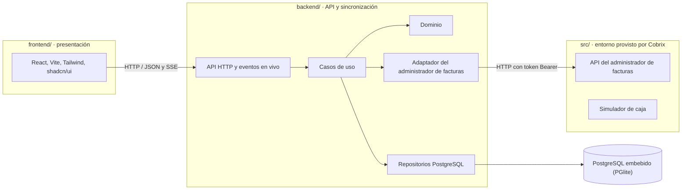

### 4.2 Capas del backend

Organicé el backend en capas con una regla de dependencia: **el código solo depende hacia adentro**. El dominio no conoce nada externo; la aplicación define *puertos* (interfaces) y la infraestructura los implementa con *adaptadores*.

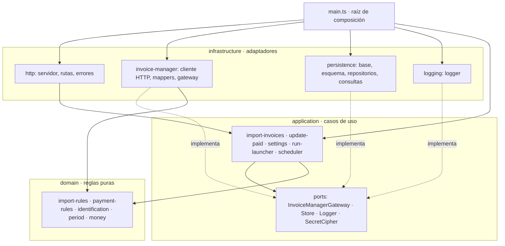

| Capa | Ubicación | Responsabilidad | Depende de |
|---|---|---|---|
| Dominio | `backend/src/domain/` | Reglas de negocio de §4 como funciones puras: reciben datos y devuelven decisiones. | Nada |
| Aplicación | `backend/src/application/` | Casos de uso (importar, actualizar pagadas, configuración, corrida automática) y los puertos que necesitan. | Dominio y puertos |
| Adaptador del ISP | `backend/src/infrastructure/invoice-manager/` | Cliente HTTP (sesión, reintentos, tiempos de espera) y *mappers* que traducen el JSON del ISP al dominio: capa anticorrupción. | Puertos y dominio |
| Persistencia | `backend/src/infrastructure/persistence/` | Esquema, repositorios (todo el SQL de escritura), consultas para el panel y cifrado de la contraseña. | Puertos |
| HTTP | `backend/src/infrastructure/http/` | Rutas, formato de errores, eventos en vivo y archivos del frontend. | Casos de uso |
| Registro | `backend/src/infrastructure/logging/` | Logs estructurados (legibles o JSON). | Puerto `Logger` |
| Composición | `backend/src/main.ts` | Único lugar que crea las implementaciones concretas y las conecta. | Todo |

Con esta separación, las reglas de clasificación (35 % de la evaluación) se prueban con datos controlados en milisegundos, y el adaptador del ISP se puede reemplazar (otro proveedor, otra versión de la API) sin tocar los casos de uso.

### 4.3 Estructura del repositorio

```
backend/
  src/
    domain/                  contract, ledger, import-rules, payment-rules,
                             identification, period, money
    application/
      ports/                 invoice-manager, store, logger
      import-invoices.ts     Caso de uso: importar y simular
      update-paid.ts         Caso de uso: actualizar pagadas y simular
      settings.ts            Validación de la configuración
      run-launcher.ts        Corridas en segundo plano y su progreso
      scheduler.ts           Corrida automática diaria
      runs.ts                Dependencias y utilidades comunes
    infrastructure/
      invoice-manager/       http-client, contract-mapper, ledger-mapper, gateway
      persistence/           database, schema, store, read-models, secret
      http/                  server, routes, errors
      logging/               logger
    shared/dates.ts          Fechas civiles en America/Caracas
    main.ts                  Raíz de composición
  test/
    unit/                    reglas.test.ts, logger.test.ts
    integration/             ciclo.test.ts, robustez.test.ts, servidor.test.ts
    helpers.ts
frontend/
  src/
    components/              layout, runs y componentes de interfaz (ui/)
    pages/                   resumen, sincronizacion, corrida, clientes,
                             expediente, configuracion
    lib/                     api, format, hooks, vocabulary
src/                         Entorno provisto por Cobrix (sin cambios de lógica)
  billing-api/               API simulada y simulador de caja
  main.ts                    Levanta el entorno y Cobrix en un proceso
test/entorno.test.ts         Pruebas del entorno provisto
docs/                        DISENO, VERIFICACION, BITACORA-IA, ENUNCIADO, API
```

### 4.4 Tecnologías

| Elección | Alternativa | Justificación |
|---|---|---|
| Node 24 con TypeScript nativo | Express, NestJS | Coincide con el entorno provisto y reduce dependencias. |
| PostgreSQL mediante PGlite | Servidor PostgreSQL, SQLite | PostgreSQL real (`numeric`, `jsonb`, índices parciales) ejecutado dentro del proceso: no requiere instalar ni levantar un servidor. |
| Montos en centavos enteros y `numeric(14,2)` | Punto flotante | La API envía valores como `24.998683`; la aritmética flotante acumula errores. |
| `node:test` | Jest, Vitest | Es el ejecutor que ya usan el proyecto y su integración continua. |
| React, Vite, Tailwind y componentes estilo shadcn/ui | HTML generado en el servidor | Sugeridos por el enunciado; componentes accesibles y consistentes. |

---

## 5. Modelo de datos

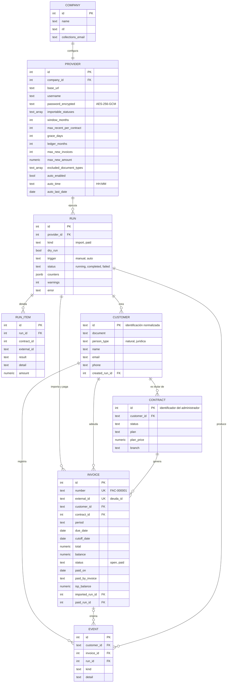

| Garantía | Mecanismo |
|---|---|
| Un cliente por titular | Clave primaria `customer.id` con la identificación normalizada. |
| Una factura por cuota | `invoice.external_id` único e inserción con `ON CONFLICT DO NOTHING`. |
| Una corrida a la vez | Índice único parcial sobre `run` donde `status = 'running'`. |
| Numeración sin huecos | Facturas y corridas se numeran «último + 1» dentro de la transacción. |
| Recuperación ante interrupciones | Al iniciar, las corridas que quedaron en curso se cierran como fallidas. |
| Coherencia del estado de pago | `CHECK ((status = 'paid') = (paid_on IS NOT NULL))`. |

---

## 6. Reglas de decisión

### 6.1 Importación de cuotas

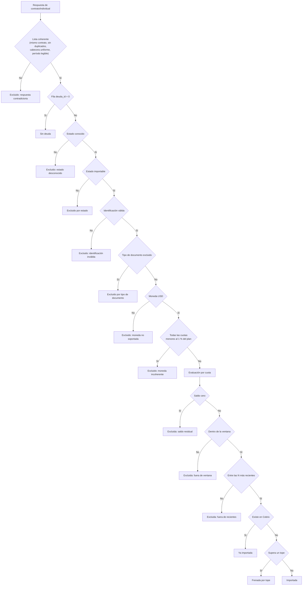

| Regla | Detalle |
|---|---|
| Cliente | Uno por identificación del titular. Se aceptan una letra opcional (V, E, J, G, P) y de 6 a 12 dígitos, sin separadores ni ceros a la izquierda. J y G son personas jurídicas. |
| Factura | Una por cuota pendiente. Identificador externo `deuda_id`; monto `deuda`. |
| Período | Se obtiene de `detalle_deuda` («PLAN - 2026 Agosto» → `2026-08`). El vencimiento es el primer día del período; el corte suma los días de gracia. |
| Moneda | Solo USD. Un contrato en USD cuyas cuotas son todas menores al 1 % del precio del plan se excluye. |
| Idempotencia | Una cuota ya importada no se vuelve a crear. |

### 6.2 Detección de pagos

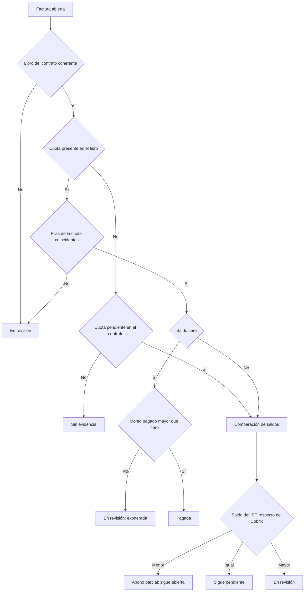

Una factura se marca pagada solo si todas las filas de su cuota en el libro coinciden, el saldo es cero y existe un monto pagado. En cualquier otro caso permanece abierta y la corrida registra el motivo.

---

## 7. Contratos de API

### 7.1 API consumida: administrador de facturas

La consume el adaptador `backend/src/infrastructure/invoice-manager/`. Todas las rutas de `/api/v1/isp/...` requieren `Authorization: Bearer <token>`. La tabla indica qué campos uso, qué rarezas maneja el adaptador y en qué tipo de dominio se traduce cada respuesta.

| Endpoint | Respuesta esperada | Rarezas manejadas | Traducción |
|---|---|---|---|
| `POST /usuario/login` `{ user_name, password }` | `200 { access_token, access_token_expires_in }` · `400 { detail: { mensaje } }` | Vencimiento en UTC sin zona; sin renovación de token. | Sesión del cliente HTTP |
| `GET /isp/lista_ids_contratos` | `200 { success, pagination: { total }, data: number[] }` | Con cualquier `estado` devuelve solo activos: se llama sin él. La paginación se ignora: se verifica `total = data.length`. | `number[]` |
| `GET /isp/contrato/individual?id_contrato=` | `200` lista **sin envoltorio**, una fila por cuota pendiente; `400 { detail }` si no existe | Filas sin orden; fila `deuda_id: "0"` = sin deuda; `deuda` redondeada; montos como texto o número. | `ContractReading` (`ok` o `contradictory`) |
| `GET /isp/pago_informacion?id_contrato=&tipo_busqueda=CUOTA&fecha_inicio=&fecha_fin=` | `200 { success: false, data: [...] }` | `success: false` aunque haya datos; una fila por cuota y por factura; cuotas futuras y fantasma; descuento con signo; sin fechas responde una ventana fija. | `LedgerReading` (filas por cuota, cuotas ilegibles) |
| `POST /usuario/me` | Siempre `500` | — | No se usa |

Campos que leo de cada fila de `contrato/individual`:

| Campo | Tipo | Uso |
|---|---|---|
| `contrato_id` | número | Debe coincidir con el contrato pedido. |
| `identificacion_contrato` | texto | Clave del cliente, tras normalizar. |
| `nombre_contrato`, `email`, `telefono`, `direccion` | texto | Datos del cliente y del contrato. |
| `estado` | texto | Estado del contrato; debe ser conocido e importable. |
| `deuda_id` | texto con dígitos | Identificador externo de la factura; `"0"` = sin deuda. |
| `deuda` | número ≥ 0 | Saldo de la cuota en USD. |
| `detalle_deuda` | lista con un texto | Período y vencimiento («PLAN - 2026 Agosto»). |
| `moneda_sigla`, `precio_servicio`, `nombre_plan`, `nombre_sucursal` | texto | Moneda, coherencia del monto, datos del contrato. |

Campos que leo de cada fila de `pago_informacion`:

| Campo | Tipo | Uso |
|---|---|---|
| `id_contrato`, `detalle_pago.id_contrato` | número | Ambos deben coincidir con el contrato pedido. |
| `id_factura`, `num_factura`, `fecha_emision` | número, texto, fecha | Factura del administrador que tocó la cuota (`0` = ninguna). |
| `detalle_pago.id_cuota` | número | Relación con la factura de Cobrix (`deuda_id`). |
| `detalle_pago.tarifa`, `valor_pago`, `descuento`, `saldo_cuota` | números | Estado actual de la cuota; todas las filas de una cuota deben coincidir. |

### 7.2 API provista: panel de Cobrix

Base: `http://127.0.0.1:4300/api`. Cuerpo y respuestas en JSON. Los montos viajan en **centavos enteros** (`amountCents`) y las fechas civiles como `YYYY-MM-DD`.

| Método y ruta | Cuerpo | Respuesta exitosa | Errores |
|---|---|---|---|
| `GET /summary` | — | `200 Summary` | — |
| `GET /settings` | — | `200 { company, provider, sandbox }` | — |
| `PUT /settings/company` | `{ name, rif, collectionsEmail }` | `200 { company, provider, sandbox }` | `422 validation_failed` |
| `PUT /settings/provider` | `{ name, baseUrl, username, password?, importableStatuses, windowMonths, maxRecentPerContract, graceDays, ledgerMonths, maxNewInvoices, maxNewAmount, excludedDocumentTypes, autoEnabled, autoTime }` | `200 { company, provider, sandbox }` | `422 validation_failed` |
| `POST /settings/provider/test` | `{ baseUrl?, username?, password? }` | `200 { ok: true, contracts, elapsedMs, message }` o `200 { ok: false, kind, message }` | — |
| `GET /runs?limit=` | — | `200 { runs: Run[], inProgress: Progress \| null }` | — |
| `POST /runs` | `{ kind: "import" \| "paid", dryRun: boolean }` | `202 { runId }` | `400 bad_request`, `409 run_in_progress` |
| `GET /runs/:id` | — | `200 Run & { items: RunItem[] }` | `404 not_found` |
| `GET /customers?q=` | — | `200 { customers: CustomerRow[] }` | — |
| `GET /customers/:id` | — | `200 { customer, contracts, invoices, events }` | `404 not_found` |
| `GET /events` | — | `text/event-stream` | — |

**Por qué «Probar conexión» responde 200 aunque falle:** la solicitud al panel se cumplió; lo que falló fue la conexión con el ISP, y ese resultado es el dato que se pide.

Formato único de error:

```json
{ "error": { "code": "validation_failed", "message": "Revisa los campos marcados.", "fields": { "rif": "El RIF debe verse así: J-12345678-9." } } }
```

| `code` | Estado | Cuándo |
|---|---|---|
| `bad_request` | 400 | JSON mal formado o parámetro inválido. |
| `not_found` | 404 | Ruta, corrida o cliente inexistente. |
| `run_in_progress` | 409 | Otra corrida tiene el bloqueo. |
| `payload_too_large` | 413 | Cuerpo mayor a 1 MB. |
| `validation_failed` | 422 | Configuración con campos inválidos; `fields` indica cuáles. |
| `upstream_error` | 502 | Falla del ISP en una llamada sincrónica. |
| `internal_error` | 500 | Error inesperado; el detalle queda solo en el registro del servidor. |

Tipos principales:

```ts
Run         { id, kind: 'import' | 'paid', dryRun, trigger: 'manual' | 'auto', status: 'running' | 'completed' | 'failed',
              startedAt, finishedAt, counters: Record<string, number>, warnings, error }
RunItem     { position, contractId, externalId, customerId, customerName, result, detail, label, amountCents }
Progress    { runId, kind, dryRun, done, total, stage }
CustomerRow { id, document, name, personType, contracts, openInvoices, paidInvoices, debtCents, oldestDueDate }
Summary     { customers, contracts, openInvoices, paidInvoices, openAmountCents, paidAmountCents,
              aging: [{ bucket, label, invoices, amountCents }], overdueCustomers, company, provider, lastRuns, inProgress, today }
```

Eventos de `GET /events`:

| Evento | Datos | Cuándo |
|---|---|---|
| `hello` | `{ inProgress }` | Al conectarse; permite mostrar una corrida ya iniciada. |
| `progress` | `Progress` | Al registrar la corrida y por cada contrato procesado. |
| `finished` | `{ runId, kind, dryRun, status, counters, error? }` | Al terminar la corrida. |

---

## 8. Diagramas de secuencia

### 8.1 Configurar el proveedor y probar la conexión

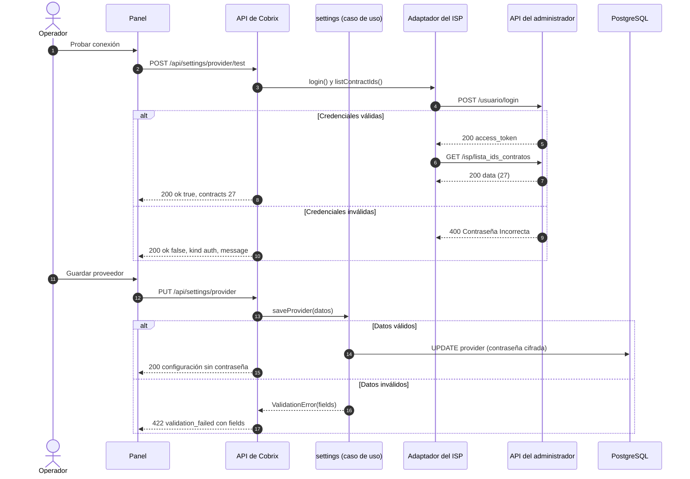

### 8.2 Lanzar una corrida y seguir su progreso

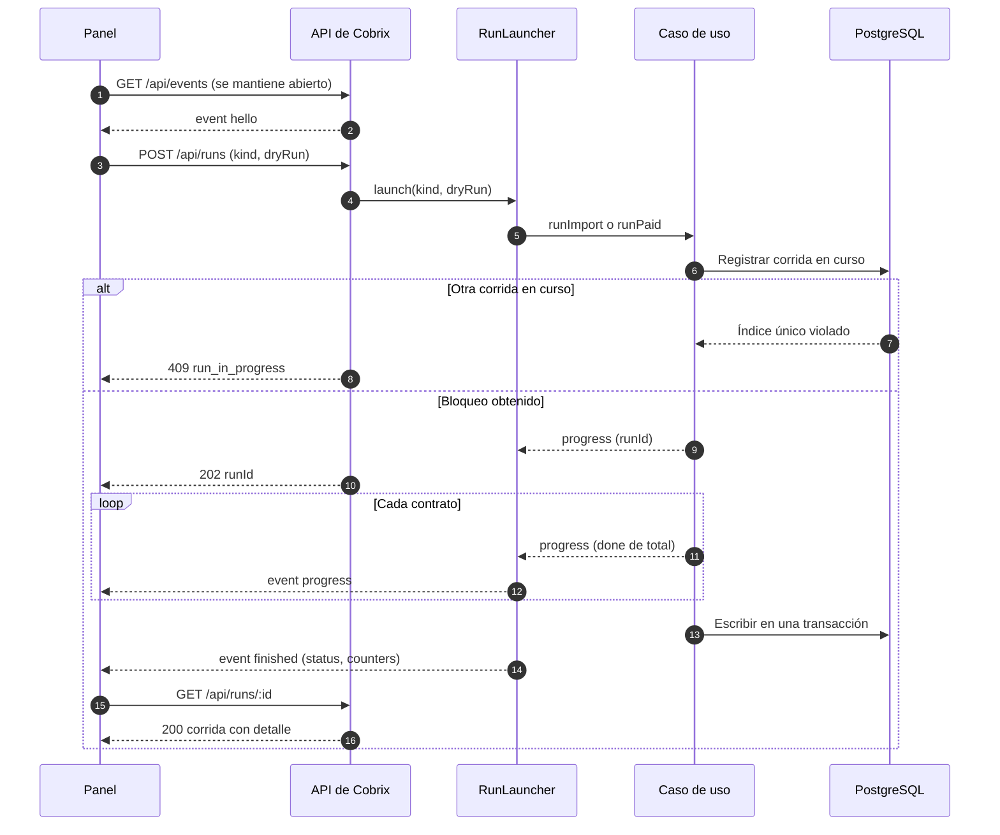

### 8.3 Importación

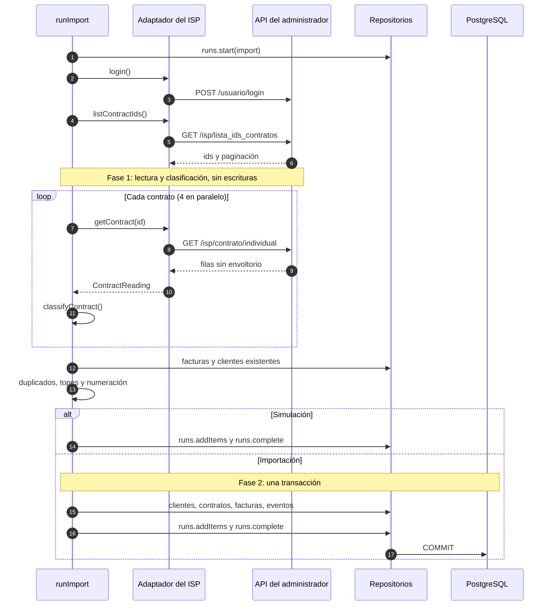

### 8.4 Actualización de pagadas

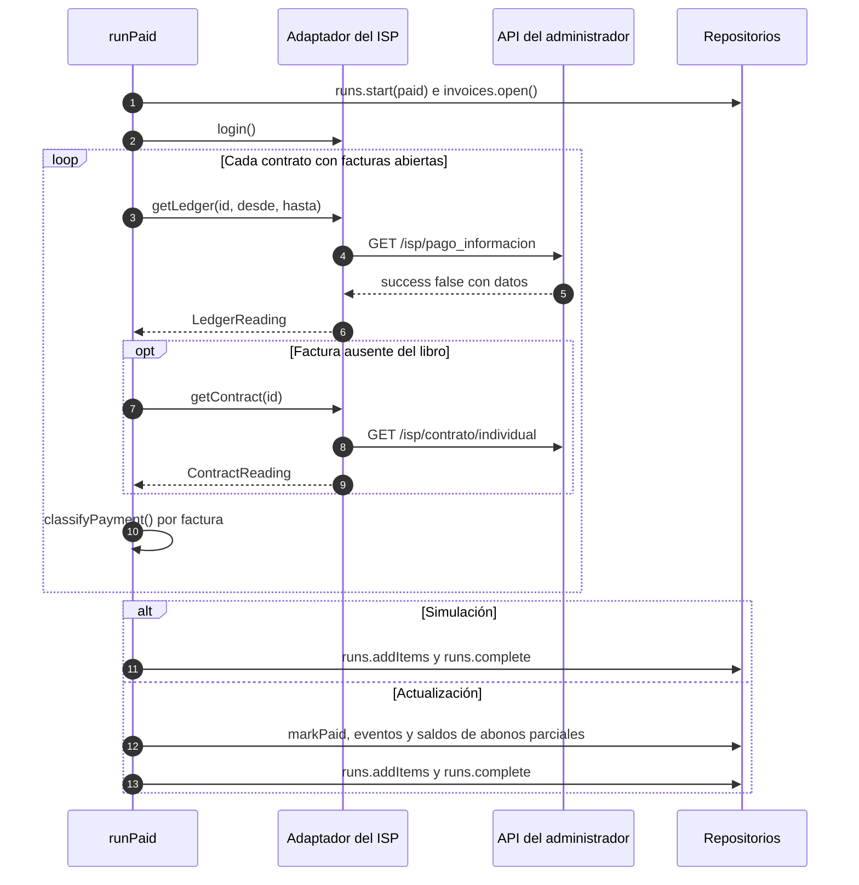

### 8.5 Renovación del token con consultas concurrentes

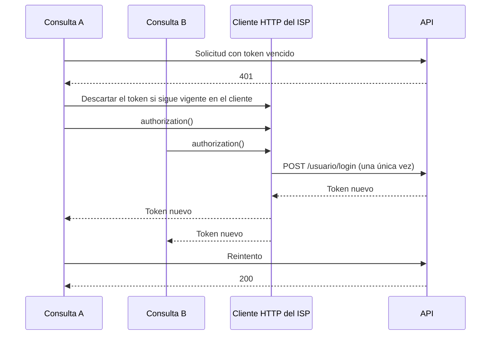

### 8.6 Consulta de clientes y expediente

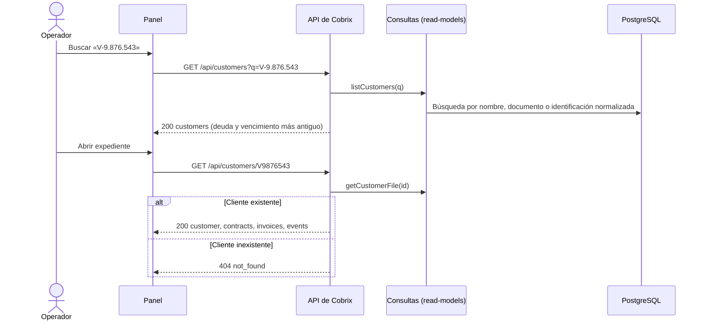

### 8.7 Ciclo de aceptación

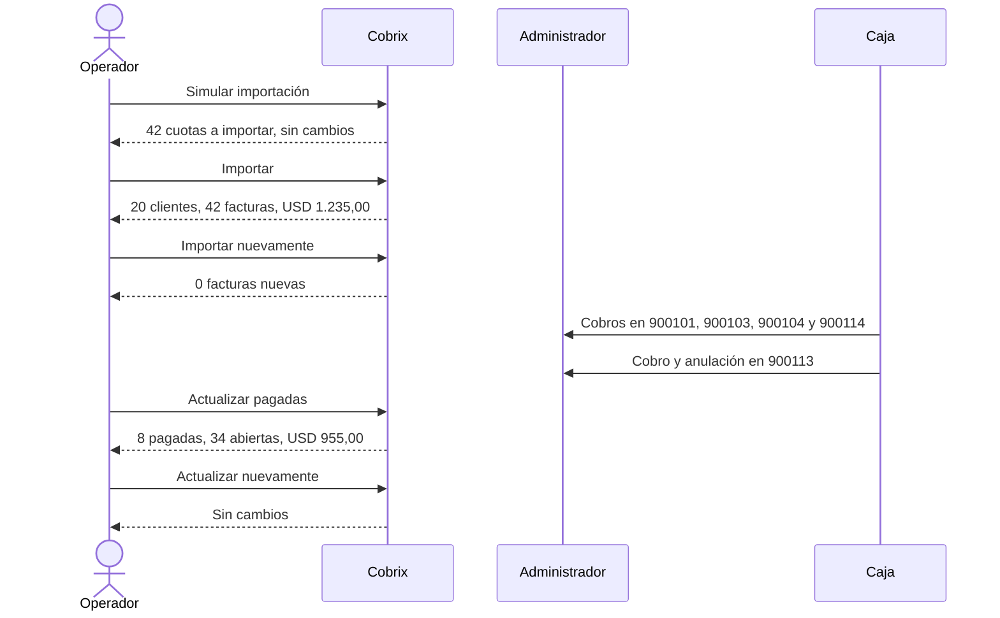

---

## 9. Diagramas de estado

### 9.1 Factura

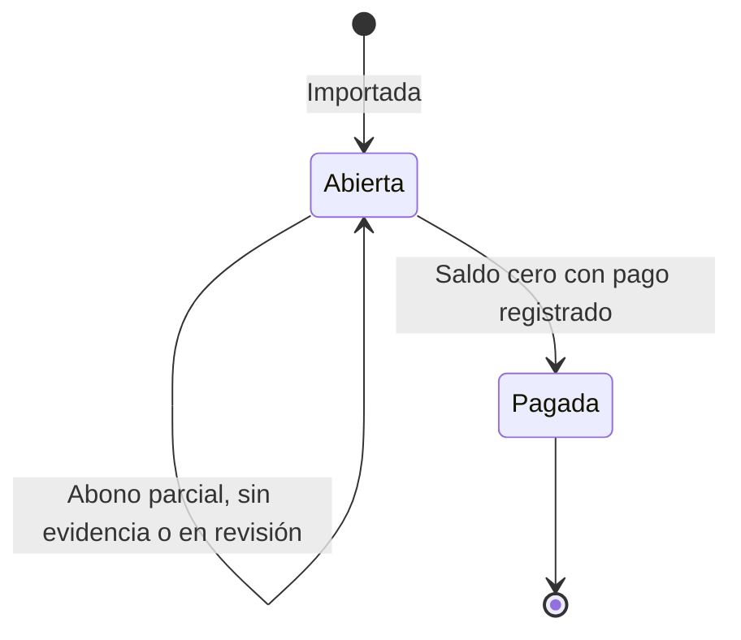

### 9.2 Corrida

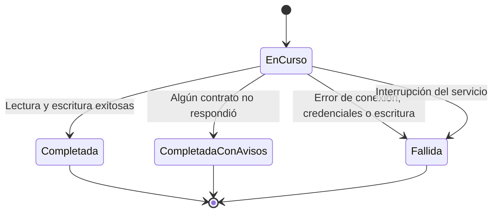

---

## 10. Manejo de errores y registro

### 10.1 Situaciones de error

| Situación | Comportamiento | Prueba |
|---|---|---|
| Credenciales inválidas | Corrida fallida con el mensaje de la API y la acción sugerida. Sin escrituras. | `robustez` |
| API inaccesible | Corrida fallida indicando la URL que no respondió. | `robustez` |
| Token vencido durante la corrida | Un único inicio de sesión nuevo; la corrida continúa. | `robustez` |
| Error 5xx en un contrato | Reintento; si persiste, se registra y la corrida continúa. | `robustez` |
| Respuesta contradictoria | Contrato excluido con el motivo. | `robustez`, `reglas` |
| Lista de contratos incompleta | Corrida fallida; se evita la importación parcial. | `robustez` |
| `success: false` con datos | Se ignora el indicador y se valida la estructura. | `reglas` |
| Libro con filas de otro contrato | Facturas del contrato en revisión; ninguna pagada. | `robustez` |
| Fila del libro ilegible | Solo esa cuota queda en revisión. | `reglas` |
| Cuota ausente del libro y del contrato | Sin evidencia; la factura no se marca pagada. | `robustez` |
| Corridas simultáneas | La segunda recibe `409 run_in_progress`. | `robustez`, `servidor` |
| Solicitud inválida al panel | Error con el formato único y su `code`. | `servidor` |
| Ejecuciones repetidas | No se duplican ni se reabren registros. | `ciclo` |

### 10.2 Registro (logs)

Cada servicio registra eventos estructurados: un nombre de evento y sus campos. El formato es legible por defecto y JSON con `LOG_FORMAT=json`; el nivel se ajusta con `LOG_LEVEL` (`debug`, `info`, `warn`, `error`, `silent`). Los campos con nombre de secreto (contraseña, token, autorización) se enmascaran siempre.

```
01:16:58.028 INFO  run.started runId=1 kind=import dryRun=false trigger=manual
01:16:58.056 INFO  isp.login component=invoice-manager baseUrl=http://127.0.0.1:4310 user=cobrix
01:16:58.273 INFO  run.finished runId=1 kind=import status=completed ms=249 installmentsImported=42 customersCreated=20
01:17:00.662 WARN  http.request method=POST path=/api/runs status=400 code=bad_request ms=1
```

| Evento | Nivel | Origen | Campos |
|---|---|---|---|
| `cobrix.started` | info | Composición | url, dataDir, today |
| `http.request` | info / warn / error | Servidor HTTP | method, path, status, ms, code |
| `run.started`, `run.finished` | info | Casos de uso | runId, kind, dryRun, trigger, ms, contadores |
| `run.failed` | error | Casos de uso | runId, ms, error |
| `run.contract_failed`, `run.contract_excluded`, `run.limit_reached`, `run.invoices_under_review` | warn | Casos de uso | runId, contractId, motivo |
| `isp.login`, `isp.token_rejected` | info | Adaptador del ISP | baseUrl, user, expiresAt |
| `isp.retry`, `isp.request_error`, `isp.request_failed` | warn | Adaptador del ISP | method, path, status, attempt |
| `isp.response` | debug | Adaptador del ISP | method, path, status, ms |
| `settings.company_saved`, `settings.provider_saved`, `settings.connection_tested` | info / warn | Configuración | sin secretos |
| `scheduler.started`, `scheduler.cycle_started`, `scheduler.cycle_finished`, `scheduler.postponed`, `scheduler.failed` | info / error | Programador | día, runIds |

---

## 11. Proceso de desarrollo

### 11.1 Etapas

| Etapa | Resultado |
|---|---|
| Análisis | Leí el enunciado, la guía de la API y el código de la API simulada, y estudié el producto de Cobrix. |
| Exploración | Extraje por HTTP los 27 contratos y el libro de pagos, y calculé a mano los criterios de aceptación antes de programar: 54 cuotas pendientes − 9 por estado − 2 por moneda incoherente − 1 residual = 42 cuotas por USD 1.235,00. |
| Dominio | Implementé las reglas de negocio como funciones puras, con pruebas regla por regla. |
| Sincronización | Construí el cliente HTTP, el esquema de datos y las corridas en dos fases, y una prueba de punta a punta con los valores exactos del enunciado. |
| Robustez | Inyecté fallas con un interceptor de `fetch`; estas pruebas revelaron dos defectos que corregí. |
| Panel | Construí la interfaz y la recorrí completa en el navegador, en escritorio y en teléfono. |
| Arquitectura | Reorganicé el repositorio en frontend y backend, con el backend en capas y el ISP detrás de un adaptador; normalicé los errores y agregué registro estructurado. |
| Documentación | Este documento, la verificación contra el enunciado y la bitácora. |

### 11.2 Método

1. **Análisis previo a la codificación.** Verifiqué los criterios de aceptación sobre los datos reales antes de implementar las reglas.
2. **Lógica antes que interfaz.** La interfaz solo presenta decisiones tomadas y probadas en el dominio.
3. **Pruebas como especificación.** `ciclo.test.ts` reproduce la sección 5 del enunciado contra la API real.
4. **Pruebas de falla.** Inyecto errores para validar el comportamiento fuera del caso esperado.
5. **Historial legible.** El primer commit contiene el proyecto provisto sin cambios; cada commit posterior es un hito con su justificación.

### 11.3 Comportamientos de la API verificados

| Comportamiento | Tratamiento |
|---|---|
| `lista_ids_contratos` con cualquier valor de `estado` devuelve solo contratos activos. | Se consulta sin ese parámetro. |
| `contrato/individual` devuelve una lista sin envoltorio ni orden; `deuda_id: "0"` indica que no hay deuda. | Lectura estricta y ordenamiento por período. |
| `deuda` llega redondeada a centavos (0,001317 → 0). | Saldo residual: no se importa. |
| Un contrato informado en USD tiene cuotas de 0,05 con un plan de 20. | Regla de moneda incoherente. |
| El libro incluye una fila por cuota y por factura que la afectó, con el estado actual de la cuota. | Todas las filas deben coincidir para considerar el pago. |
| Una cuota sin cobros figura con fecha de fin de su mes. | La cuota del mes en curso se verifica en el contrato. |
| Una cuota exonerada tiene descuento negativo igual a la tarifa, saldo cero y pago cero. | El descuento admite signo; la exoneración no es un pago. |
| Una anulación conserva la fila de la factura anulada y restituye el saldo. | Se decide por el saldo, no por la existencia de un cobro. |
| El libro incluye cuotas futuras y cuotas que no figuran como pendientes. | Se busca por identificador de cuota; el libro nunca origina importaciones. |
| `/usuario/me` responde siempre con error 500. | No se utiliza. |
| Sin fechas, el libro responde con una ventana fija de 2025. | Las fechas se envían siempre. |

---

## 12. Decisiones de diseño

| Tema | Decisión | Justificación |
|---|---|---|
| Moneda incoherente | Excluyo el contrato si **todas** sus cuotas con saldo son menores al 1 % del precio del plan. | Un residuo menor en un contrato normal no debe impedir el cobro del resto. |
| Topes por corrida | Al alcanzar un tope, se frenan todas las cuotas siguientes de la corrida. | Comportamiento predecible; no se omiten cuotas antiguas a favor de otras de menor monto. |
| Identificación sin letra | Se acepta como persona natural y no la alcanza el filtro por tipo de documento. | No se infiere el tipo de documento. |
| Dos cuotas del mismo período | El contrato se excluye por respuesta contradictoria. | No es posible determinar cuál es válida. |
| Abono parcial | Registro el saldo informado por el ISP; el saldo de Cobrix no cambia. | Cobrix aplica únicamente cuotas saldadas; así se obtienen los USD 955,00 del enunciado. |
| Cuota exonerada | Queda en revisión. | Existe evidencia, pero no constituye un pago. |
| Saldo del ISP mayor al de Cobrix | Queda en revisión. | Puede deberse a la anulación de un cobro previo a la importación. |
| Contratos almacenados | Todos los del titular, importables o no. | El expediente los muestra como contexto. |
| Datos de contacto | Se registran al crear el cliente. | Evita que un contrato desactualizado los reemplace. |
| Ventana del libro | Desde la fecha actual menos N meses hasta la fecha actual; siete meses por defecto. | Coincide con la referencia del enunciado. |
| Numeración | Facturas y corridas «último + 1» en la transacción, sin secuencias. | Una secuencia deja huecos si el proceso se detiene de golpe. |
| ISP detrás de un adaptador | Los *mappers* traducen el JSON del ISP al dominio en la capa de infraestructura. | Otro administrador de facturas se integra con un adaptador nuevo, sin tocar reglas ni casos de uso. |
| Formato de errores | Un único sobre `{ error: { code, message, fields? } }`. | El panel y cualquier cliente tratan todos los errores igual. |
