# Documento de diseño

Integración de Cobrix con el administrador de facturas de un proveedor de internet (ISP).

| | |
|---|---|
| Autor | Roby Durán |
| Referencias | [Enunciado](ENUNCIADO.md) · [Guía de la API](API.md) · [Bitácora de desarrollo](BITACORA-IA.md) |
| Estado | Sincronización, API y panel completos y probados. Pendiente: README y nota de entrega. |

## Contenido

1. [Contexto y objetivo](#1-contexto-y-objetivo)
2. [Actores](#2-actores)
3. [Casos de uso](#3-casos-de-uso)
4. [Arquitectura](#4-arquitectura)
5. [Modelo de datos](#5-modelo-de-datos)
6. [Reglas de decisión](#6-reglas-de-decisión)
7. [Diagramas de secuencia](#7-diagramas-de-secuencia)
8. [Diagramas de estado](#8-diagramas-de-estado)
9. [Manejo de errores](#9-manejo-de-errores)
10. [Proceso de desarrollo](#10-proceso-de-desarrollo)
11. [Decisiones de diseño](#11-decisiones-de-diseño)
12. [Trabajo pendiente](#12-trabajo-pendiente)

---

## 1. Contexto y objetivo

Cobrix gestiona la cobranza de proveedores de internet. Cada ISP registra a sus clientes, contratos, cuotas mensuales y cobros en su propio administrador de facturas. Cobrix necesita:

1. **Importar** las cuotas pendientes como facturas abiertas, agrupadas por cliente.
2. **Detectar los cobros** que el ISP ya registró en su caja, para marcar esas facturas como pagadas y dejar de gestionarlas.

Un error en cualquiera de los dos sentidos tiene costo. Marcar como pagada una factura impaga implica dejar de cobrar una deuda real. Importar una cuota que no corresponde implica cobrar a quien no se debe. Por eso el principio rector del diseño es **no inferir**: ante una respuesta ambigua o contradictoria, el sistema no actúa y registra el motivo.

## 2. Actores

| Actor | Tipo | Responsabilidad |
|---|---|---|
| Operador de cobranza | Usuario | Configura la integración, ejecuta y simula corridas, consulta clientes y resultados. |
| Programador | Proceso interno | Ejecuta la corrida automática diaria a la hora configurada (America/Caracas). |
| Administrador de facturas | Sistema externo | Expone contratos, cuotas pendientes y el libro de cuotas y pagos. |
| Caja del ISP | Sistema externo | Registra cobros y anulaciones. En la prueba se simula con las rutas `/__sim/*`. |

## 3. Casos de uso

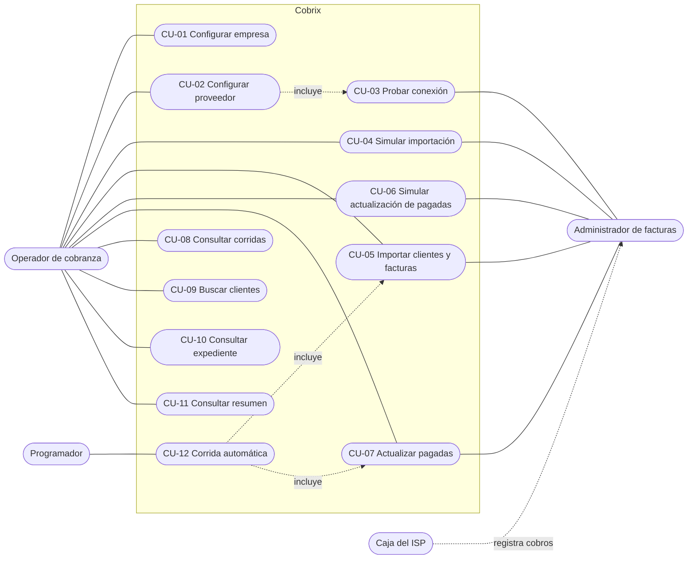

| Caso de uso | Enunciado | Lógica | Interfaz |
|---|---|---|---|
| CU-01 Configurar empresa | §3.1 | Completo | Completo |
| CU-02 Configurar proveedor | §3.1 | Completo | Completo |
| CU-03 Probar conexión | §3.1 | Completo | Completo |
| CU-04 y CU-05 Simular importación e importar | §3.2 | Completo | Completo |
| CU-06 y CU-07 Simular y actualizar pagadas | §3.3 | Completo | Completo |
| CU-08 Consultar corridas | §3.4 | Completo | Completo |
| CU-09 Buscar clientes | §3.5 | Completo | Completo |
| CU-10 Consultar expediente | §3.6 | Completo | Completo |
| CU-11 Consultar resumen | §3.8 | Completo | Completo |
| CU-12 Corrida automática | §3.1 | Completo | Completo |

### CU-02 Configurar proveedor

**Actor:** operador. **Postcondición:** configuración guardada; contraseña cifrada.

Flujo principal:

1. El operador ingresa la URL de la API (con o sin `/api/v1`), el usuario y la contraseña.
2. Define las reglas de importación: estados importables (por defecto ACTIVO y CORTADO), ventana de importación (3, 6, 9 o 12 meses, o sin ventana), máximo de cuotas recientes por contrato (1 a 60), días de gracia (0 a 60), topes por corrida, tipos de documento excluidos y corrida automática.
3. El sistema valida cada campo y guarda.

Flujos alternativos:

- **Datos inválidos:** se indica el error en cada campo con la corrección esperada. No se guarda nada.
- **Contraseña vacía al editar:** se conserva la vigente. La contraseña nunca se devuelve a la interfaz.
- **Ningún estado importable seleccionado:** se rechaza, porque ninguna cuota podría importarse.

### CU-03 Probar conexión

Inicia sesión con los datos del formulario e informa la cantidad de contratos disponibles. Distingue credenciales rechazadas, URL inválida, servicio inaccesible y tiempo de espera agotado, cada uno con una indicación de cómo resolverlo.

### CU-04 y CU-05 Simular importación e importar

**Precondiciones:** proveedor configurado; ninguna otra corrida en curso.
**Postcondición (importar):** clientes, contratos, facturas y eventos de historial creados en una única transacción; corrida registrada con contadores y una fila de detalle por cuota.
**Postcondición (simular):** solo se registra la corrida, marcada como simulación. No se modifica ningún dato.

Flujo principal:

1. Se registra la corrida en estado «en curso».
2. Se inicia sesión y se obtiene la lista de contratos **sin** el parámetro `estado` (con cualquier valor, la API devuelve solo los activos).
3. Para cada contrato (cuatro en paralelo) se obtienen las cuotas pendientes y se clasifican según las reglas de la [sección 6.1](#61-importación-de-cuotas).
4. Para cada cuota elegible se consulta el estado en Cobrix: ya importada, frenada por tope o importable.
5. En la importación real, se escribe todo en una transacción. Las facturas se numeran `FAC-000001` en adelante.
6. Se cierra la corrida con sus contadores.

Flujos alternativos:

- **Credenciales inválidas o API inaccesible:** la corrida termina fallida con el mensaje de error. No se escriben datos.
- **Lista de contratos inconsistente con su paginación:** la corrida falla para evitar una importación parcial.
- **Un contrato no responde tras los reintentos:** se registra como consulta fallida y la corrida continúa con los demás. La siguiente corrida lo incorpora.
- **Token vencido:** se inicia sesión nuevamente una sola vez.
- **Respuesta contradictoria** (filas de otro contrato, cuotas duplicadas, cabecera inconsistente, período ilegible): el contrato se excluye con el motivo.
- **Error al escribir:** se revierte la transacción y la corrida queda fallida.

### CU-06 y CU-07 Simular y actualizar pagadas

**Precondiciones:** existen facturas abiertas; ninguna otra corrida en curso.
**Postcondición:** facturas pagadas con fecha y número de la factura del administrador que las saldó; evento en el historial del cliente.

Flujo principal:

1. Se agrupan las facturas abiertas por contrato.
2. Para cada contrato se consulta el libro de cuotas (`pago_informacion`) desde la fecha actual menos la ventana configurada (siete meses por defecto) hasta la fecha actual.
3. Si una factura no figura en el libro, como ocurre con la cuota del mes en curso, se consulta el contrato.
4. Cada factura se clasifica según la [sección 6.2](#62-detección-de-pagos).
5. En la actualización real, se marcan las pagadas y se registra el saldo informado por el ISP en los abonos parciales, en una transacción.

Flujos alternativos:

- **Libro con filas de otro contrato:** las facturas del contrato quedan en revisión y ninguna se marca pagada.
- **Abono parcial:** se informa; la factura sigue abierta con su saldo original.
- **Cuota exonerada** (saldo cero sin pago registrado): no constituye un pago; queda en revisión.
- **Cuota ausente del libro y del contrato:** sin evidencia. No se marca pagada.

### CU-08 a CU-11 Consultas

| Caso de uso | Información |
|---|---|
| CU-08 Corridas | Listado con tipo, fecha, simulación, estado y resumen. El detalle muestra los contadores y una fila por cuota con resultado y motivo. |
| CU-09 Clientes | Búsqueda por nombre, cédula o RIF. Documento, tipo de persona, contratos, facturas abiertas y pagadas, deuda y vencimiento más antiguo. |
| CU-10 Expediente | Totales, datos del cliente, contratos en el administrador, facturas e historial. |
| CU-11 Resumen | Totales, proveedor configurado, estado de la corrida automática, últimas corridas y accesos directos. |

### CU-12 Corrida automática

A la hora configurada (America/Caracas), si está habilitada, ejecuta la importación y a continuación la actualización de pagadas. Registra la fecha de la última ejecución para no repetirla el mismo día, incluso tras un reinicio.

---

## 4. Arquitectura

### 4.1 Componentes

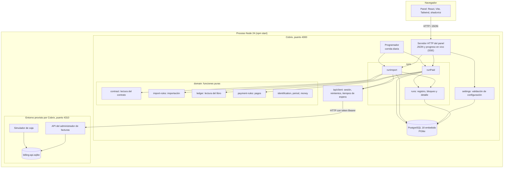

### 4.2 Capas

| Capa | Ubicación | Responsabilidad | Dependencias |
|---|---|---|---|
| Dominio | `src/cobrix/domain/` | Reglas de negocio como funciones puras: reciben datos y devuelven decisiones. | Ninguna |
| Cliente del ISP | `src/cobrix/isp/` | Sesión con token de dos horas, reintentos, tiempos de espera y mensajes de error. No interpreta las respuestas. | `fetch` |
| Sincronización | `src/cobrix/sync/` | Corridas en dos fases: lectura y decisión, luego escritura. Contadores y detalle. | Dominio, cliente, base |
| Configuración | `src/cobrix/settings.ts` | Lectura, validación por campo y almacenamiento. | Base |
| Persistencia | `src/cobrix/db/` | Esquema, conexión y cifrado de la contraseña. | PGlite |
| Interfaz | `panel/` | Pantallas del operador. | API del panel |

La clasificación de respuestas es el criterio de mayor peso en la evaluación. Aislarla en funciones puras permite probar cada regla con datos controlados en milisegundos. Las pruebas de integración usan la API real del entorno.

### 4.3 Tecnologías

| Elección | Alternativa | Justificación |
|---|---|---|
| Node 24 con TypeScript nativo | Express, NestJS | Coincide con el entorno provisto y reduce dependencias. |
| PostgreSQL mediante PGlite | Servidor PostgreSQL, SQLite | PostgreSQL real (tipos `numeric` y `jsonb`, secuencias, índices parciales) que se ejecuta dentro del proceso. No requiere instalar ni levantar un servidor. |
| Montos en centavos enteros y `numeric(14,2)` | Punto flotante | La API envía valores como `24.998683`; la aritmética flotante acumula errores. |
| `node:test` | Jest, Vitest | Es el ejecutor que ya usan el proyecto y su integración continua. |
| React, Vite, Tailwind y shadcn/ui | HTML generado en el servidor | Sugeridos por el enunciado; componentes accesibles y consistentes. |

### 4.4 Estructura del repositorio

```
src/
  billing-api/          API simulada y simulador de caja (provisto, sin cambios)
  shared/dates.ts       Fechas civiles en America/Caracas (provisto)
  cobrix/
    domain/             contract, import-rules, ledger, payment-rules,
                        identification, period, money
    isp/client.ts       Cliente HTTP del administrador
    db/                 database, schema, secret
    sync/               runs, import, paid
    settings.ts         Configuración
test/
  reglas.test.ts        Reglas de negocio, una por una
  ciclo.test.ts         Criterios de aceptación contra la API real
  robustez.test.ts      Fallas inyectadas
  entorno.test.ts       Pruebas del entorno provisto
docs/
  DISENO.md, BITACORA-IA.md, ENUNCIADO.md, API.md
```

---

## 5. Modelo de datos

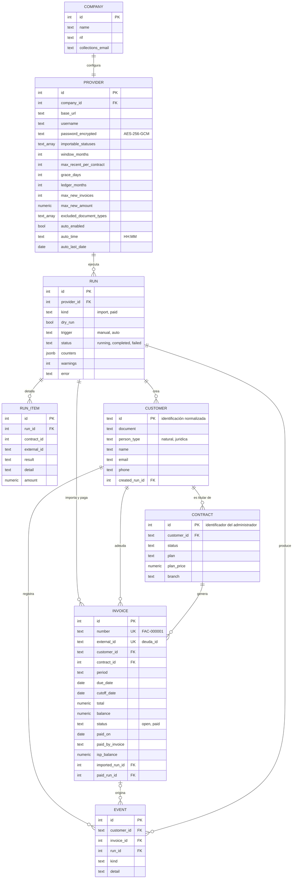

| Tabla | Propósito |
|---|---|
| `company` | Datos de la empresa: nombre, RIF y correo de cobranza. Registro único. |
| `provider` | Conexión y reglas de importación del administrador de facturas de la empresa. |
| `run` | Cada corrida: tipo, simulación, origen, estado, contadores y error. |
| `run_item` | Resultado y motivo de cada cuota o factura evaluada en una corrida. |
| `customer` | Un registro por titular, identificado por su documento normalizado. |
| `contract` | Contratos del titular en el administrador, importables o no. |
| `invoice` | Una factura por cuota; estado, saldo y evidencia de pago. |
| `event` | Historial del cliente: alta, factura importada y factura pagada. |

Garantías aplicadas por la base de datos:

| Garantía | Mecanismo |
|---|---|
| Un cliente por titular | Clave primaria `customer.id` con la identificación normalizada. |
| Una factura por cuota | `invoice.external_id` único e inserción con `ON CONFLICT DO NOTHING`. |
| Una corrida a la vez | Índice único parcial sobre `run` donde `status = 'running'`. |
| Recuperación ante interrupciones | Al iniciar, las corridas que quedaron en curso se cierran como fallidas. |
| Coherencia del estado de pago | `CHECK ((status = 'paid') = (paid_on IS NOT NULL))`. |
| Rangos de configuración | Restricciones `CHECK` en ventana, días de gracia, máximo de cuotas y hora. |

---

## 6. Reglas de decisión

### 6.1 Importación de cuotas

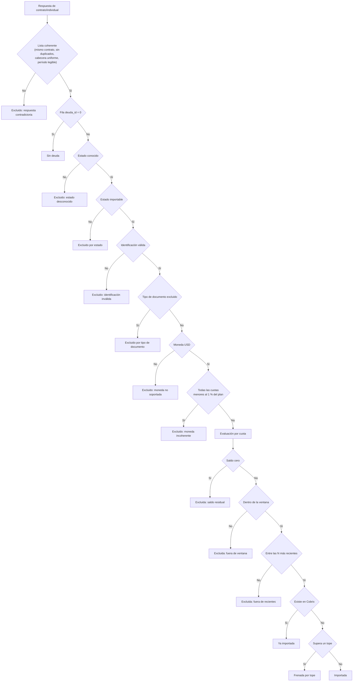

| Regla | Detalle |
|---|---|
| Cliente | Uno por identificación del titular. Se aceptan una letra opcional (V, E, J, G, P) y de 6 a 12 dígitos, sin separadores ni ceros a la izquierda. J y G son personas jurídicas. |
| Factura | Una por cuota pendiente. Identificador externo `deuda_id`; monto `deuda`. |
| Período | Se obtiene de `detalle_deuda` («PLAN - 2026 Agosto» → `2026-08`). El vencimiento es el primer día del período; el corte suma los días de gracia. |
| Moneda | Solo USD. Un contrato en USD cuyas cuotas son todas menores al 1 % del precio del plan se excluye. |
| Idempotencia | Una cuota ya importada no se vuelve a crear. |

### 6.2 Detección de pagos

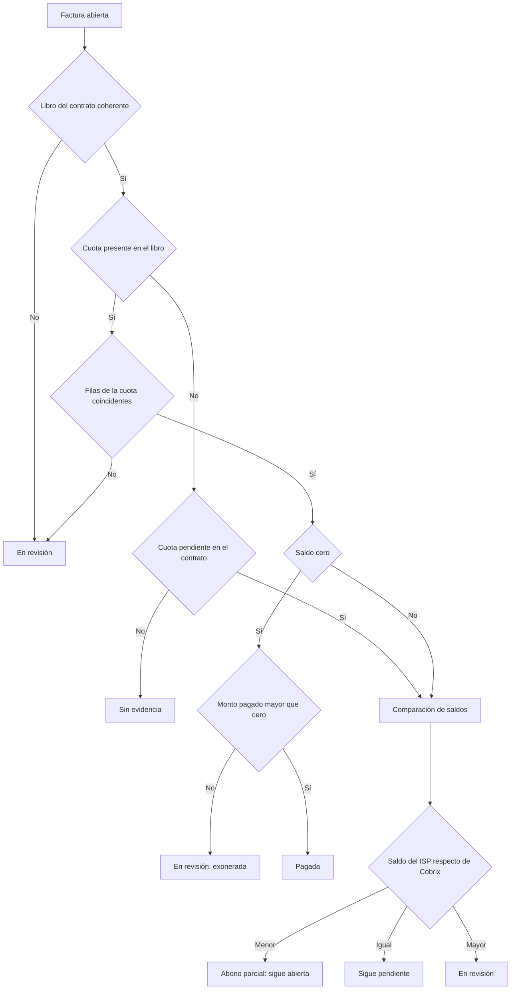

Una factura se marca pagada solo si todas las filas de su cuota en el libro coinciden, el saldo es cero y existe un monto pagado. En cualquier otro caso permanece abierta y la corrida registra el motivo.

---

## 7. Diagramas de secuencia

### 7.1 Importación

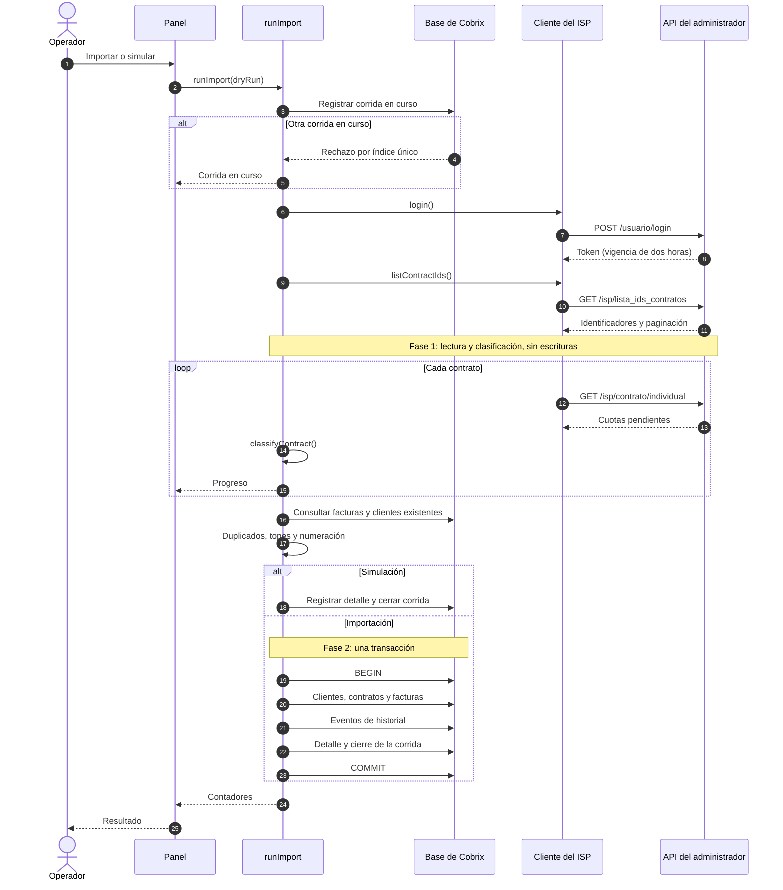

### 7.2 Actualización de pagadas

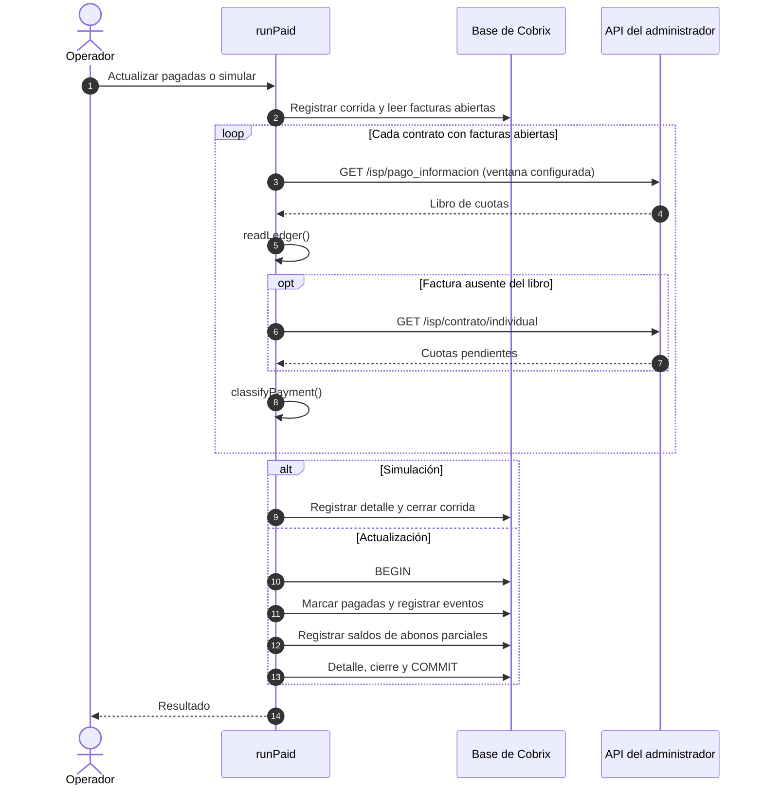

### 7.3 Renovación del token con consultas concurrentes

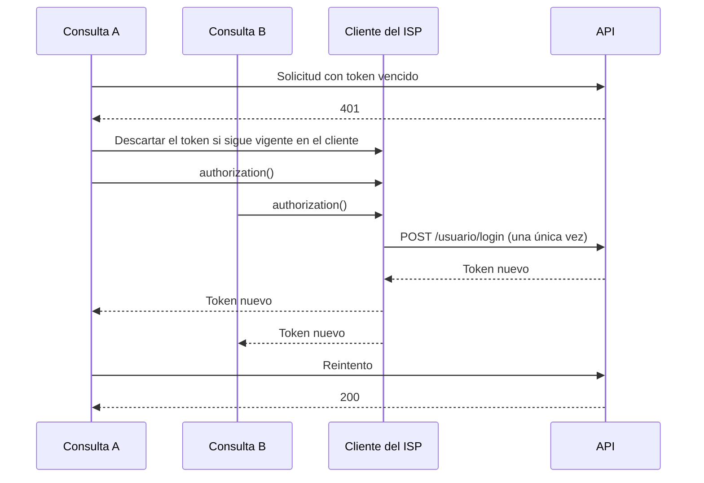

### 7.4 Ciclo de aceptación

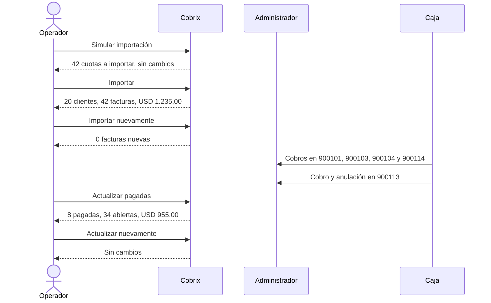

---

## 8. Diagramas de estado

### 8.1 Factura

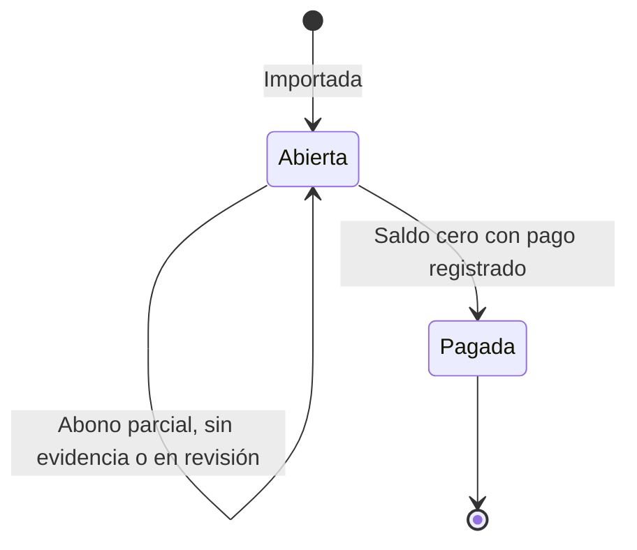

### 8.2 Corrida

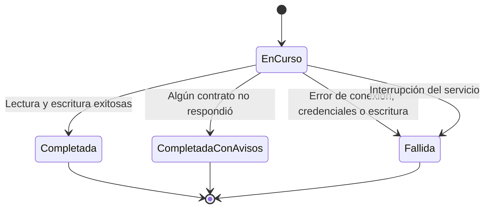

Una corrida completada con avisos se almacena como `completed` con `warnings` mayor que cero.

---

## 9. Manejo de errores

| Situación | Comportamiento | Prueba |
|---|---|---|
| Credenciales inválidas | Corrida fallida con el mensaje de la API y la acción sugerida. Sin escrituras. | `robustez` |
| API inaccesible | Corrida fallida indicando la URL que no respondió. | `robustez` |
| Token vencido durante la corrida | Un único inicio de sesión nuevo; la corrida continúa. | `robustez` |
| Error 5xx en un contrato | Reintento; si persiste, se registra y la corrida continúa. | `robustez` |
| Respuesta contradictoria | Contrato excluido con el motivo. | `robustez`, `reglas` |
| Lista de contratos incompleta | Corrida fallida; se evita la importación parcial. | `robustez` |
| `success: false` con datos | Se ignora el indicador y se valida la estructura. | `reglas` |
| Libro con filas de otro contrato | Facturas del contrato en revisión; ninguna pagada. | `robustez` |
| Fila del libro ilegible | Solo esa cuota queda en revisión. | `reglas` |
| Cuota ausente del libro y del contrato | Sin evidencia; la factura no se marca pagada. | `robustez` |
| Corridas simultáneas | La segunda se rechaza. | `robustez` |
| Topes por corrida | El excedente queda frenado y se procesa en la siguiente corrida. | `robustez` |
| Ejecuciones repetidas | No se duplican ni se reabren registros. | `ciclo` |
| Interrupción del servicio | Al reiniciar, la corrida pendiente se cierra como fallida. | `openDatabase` |

---

## 10. Proceso de desarrollo

### 10.1 Etapas

| Etapa | Resultado |
|---|---|
| Análisis | Lectura del enunciado, de la guía de la API y del código de la API simulada. Estudio del producto de Cobrix. |
| Exploración | Extracción de los 27 contratos y del libro de pagos por HTTP. Cálculo manual de los criterios de aceptación antes de programar: 54 cuotas pendientes − 9 por estado − 2 por moneda incoherente − 1 residual = 42 cuotas por USD 1.235,00. |
| Dominio | Reglas de negocio como funciones puras, con 32 pruebas. |
| Sincronización | Cliente HTTP, esquema de datos y corridas en dos fases. Prueba de punta a punta con los valores exactos del enunciado. |
| Robustez | 11 pruebas con fallas inyectadas mediante un interceptor de `fetch`. Detectaron dos defectos, ya corregidos. |
| Documentación | Este documento y la bitácora de desarrollo. |

### 10.2 Método

1. **Análisis previo a la codificación.** Los criterios de aceptación se verificaron a mano sobre los datos reales antes de implementar las reglas.
2. **Lógica antes que interfaz.** La interfaz solo presenta decisiones ya tomadas y probadas en el dominio.
3. **Pruebas como especificación.** `ciclo.test.ts` reproduce la sección 5 del enunciado contra la API real.
4. **Pruebas de falla.** Se inyectan errores para validar el comportamiento fuera del caso esperado.
5. **Historial legible.** El primer commit contiene el proyecto provisto sin cambios; los siguientes, un hito cada uno, con su justificación.

### 10.3 Comportamientos de la API verificados

| Comportamiento | Tratamiento |
|---|---|
| `lista_ids_contratos` con cualquier valor de `estado` devuelve solo contratos activos. | Se consulta sin ese parámetro. |
| `contrato/individual` devuelve una lista sin envoltorio ni orden; `deuda_id: "0"` indica que no hay deuda. | Lectura estricta y ordenamiento por período. |
| `deuda` llega redondeada a centavos (0,001317 → 0). | Saldo residual: no se importa. |
| Un contrato informado en USD tiene cuotas de 0,05 con un plan de 20. | Regla de moneda incoherente. |
| El libro incluye una fila por cuota y por factura que la afectó, con el estado actual de la cuota. | Todas las filas deben coincidir para considerar el pago. |
| Una cuota sin cobros figura con fecha de fin de su mes. | La cuota del mes en curso se verifica en el contrato. |
| Una cuota exonerada tiene descuento negativo igual a la tarifa, saldo cero y pago cero. | El descuento admite signo; la exoneración no es un pago. |
| Una anulación conserva la fila de la factura anulada y restituye el saldo. | Se decide por el saldo, no por la existencia de un cobro. |
| El libro incluye cuotas futuras y cuotas que no figuran como pendientes. | Se busca por identificador de cuota; el libro nunca origina importaciones. |
| `/usuario/me` responde siempre con error 500. | No se utiliza. |
| Sin fechas, el libro responde con una ventana fija de 2025. | Las fechas se envían siempre. |

### 10.4 Estado de las pruebas

57 pruebas, todas satisfactorias: 32 de reglas, 11 del ciclo de aceptación, 11 de robustez y 3 del entorno provisto.

---

## 11. Decisiones de diseño

| Tema | Decisión | Justificación |
|---|---|---|
| Moneda incoherente | Se excluye el contrato si **todas** sus cuotas con saldo son menores al 1 % del precio del plan. | Un residuo menor en un contrato normal no debe impedir el cobro del resto. |
| Topes por corrida | Al alcanzar un tope, se frenan todas las cuotas siguientes de la corrida. | Comportamiento predecible; no se omiten cuotas antiguas a favor de otras de menor monto. |
| Identificación sin letra | Se acepta como persona natural y no la alcanza el filtro por tipo de documento. | No se infiere el tipo de documento. |
| Dos cuotas del mismo período | El contrato se excluye por respuesta contradictoria. | No es posible determinar cuál es válida. |
| Abono parcial | Se registra el saldo informado por el ISP; el saldo de Cobrix no cambia. | Cobrix aplica únicamente cuotas saldadas; así se obtienen los USD 955,00 del enunciado. |
| Cuota exonerada | Queda en revisión. | Existe evidencia, pero no constituye un pago. |
| Saldo del ISP mayor al de Cobrix | Queda en revisión. | Puede deberse a la anulación de un cobro previo a la importación. |
| Contratos almacenados | Todos los del titular, importables o no. | El expediente muestra los contratos del administrador como contexto. |
| Datos de contacto | Se registran al crear el cliente. | Evita que un contrato desactualizado los reemplace. |
| Ventana del libro | Desde la fecha actual menos N meses hasta la fecha actual; siete meses por defecto. | Coincide con la referencia del enunciado. |
| Relaciones de configuración | `provider` referencia a `company` y `run` referencia a `provider`. | Cada corrida queda asociada al proveedor que consultó y el modelo admite varios proveedores en el futuro. |

## 12. Trabajo pendiente

- README con instrucciones de instalación y nota final de entrega.
